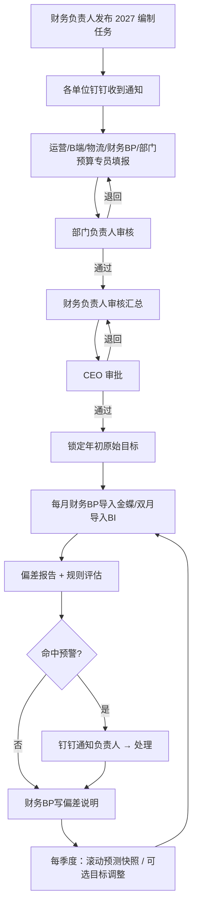
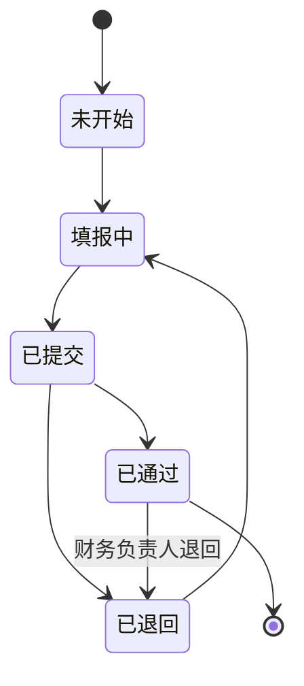

# 预算管理平台 · PRD

**版本**: v4（锁定后可补录新币种汇率；Design 回传：汇率锁定与月均汇率、品效折后、填报单位、CEO 整次终审、预算科目清单、B 端报表行、BI 校验、规则退回；requirements revision 3）
**状态**: 定稿待 Design
**作者**: PRD 大师协作产出
**日期**: 2026-10-27
**品类**: B 端 SaaS（公司内部部署）

> 需求条目、验收条件与非功能要求的唯一行为契约是 `requirements.md`（revision 2）。本文解释价值、场景与取舍，并引用对应 ID。上游输入：`解题方案书.md`（已确认）。

---

## 0. 阶段路线图与 MVP 定义

| 阶段 | 已确认目标 | 功能模块 | 交付物（做完用户拿到什么） |
| :--- | :--- | :--- | :--- |
| 本期（完整闭环） | 2026-12-01 发布编制任务、2026-12-31 前 CEO 审批锁定 2027 年预算（钉钉应用 2026-11-30 前就绪，来源：OQ-22、OQ-25），并支撑 2027 年 1–6 月试运行 | F01–F14 | 钉钉登录的内部网页系统：下发编制 → 各部门填报 → 三级审批锁定目标 → 每月导入金蝶/BI 实际 → 偏差报告与钉钉预警 → 季度目标调整与滚动预测 → 预算规则库 → Excel 导出 |
| 后续阶段 | 现金流预算；金蝶星空 WebAPI 自动取数 | 未建 REQ | 本期不交付 |

> **本次范围与完成定义**：scope = 本期，覆盖 F01–F14、全部平台渠道（Amazon、Wayfair、Home Depot、Lowe's、独立站、其他）、B 端客户（美国业务部、外贸部）和全部 15 个部门；网页端，桌面浏览器与钉钉内置浏览器。完成定义见 `proposal-v1.md`「MVP 划分」七条，来源：用户确认（state.json OQ-1 选 A、stage1_shared_understanding）。明确不做：现金流预算、星空 WebAPI、独立费用申请审批流、大模型、SKU 级预算、金蝶单据级费用控制、公共费用分摊。

---

## 1. 项目背景与收益

### 1.1 需求简介（一句话）

公司业务规模、渠道、品类和部门持续增加，收入、利润和现金流波动加大，但目前没有预算。本期建设一套按「月 × 渠道 × 站点 × 品类 × 新老品」编制、逐级审批锁定、按季滚动、按月对比金蝶实际并预警的全面预算系统，用来指导年度目标制定、跟踪执行偏差和评价结果。

### 1.2 收益预估

#### 用户收益

- 财务负责人和财务 BP 不再手工汇总 15 个部门的 Excel；填报、审批、版本集中在一个系统 —— 依据：C（用户前身经验：Excel 预算导致版本与管控问题）—— 来源：解题方案书 §3
- 各部门在填报时能看到本部门同科目的历史实际，培训、福利等临时活动有预留额度和往年参考 —— 依据：B —— 来源：用户访谈（OQ-3）

#### 业务收益

- 每季度初预测的该季度各月净利润率，与金蝶实际偏差在 ±1.5 个百分点以内（2027 年 1–6 月）—— 依据：用户确认的成功标准 —— 来源：解题方案书 §6，PRD 访谈 OQ-16
- 按年初原始目标计算的上半年净利润达成率在 90%–110% —— 来源：解题方案书 §6
- 固定费用（部门费用）增速不超过收入增速 —— 来源：解题方案书 §6
- 基线：目前无预算，月度净利润率在 2%–7% 之间波动，平均 5% —— 依据：用户估算，待验证（数据小试）

#### 不做风险

- 渠道和品类之间的利润差异继续看不清，月度波动只能事后发现 —— 依据：用户告知
- 新渠道预算过度乐观、固定费用失控的问题重演 —— 依据：用户前身经验，来源：解题方案书 §3

---

## 2. 用户画像

### 2.1 角色与权限矩阵（B 端必须）

多角色：各角色的目标、可操作内容、可见数据范围和流程责任不同，因此分别定义。

| 角色 | 典型职位 | 公司规模 | 行业 | 决策权 | 使用频次 | 关键场景 |
|------|---------|---------|------|--------|---------|---------|
| CEO | 总经理 | 150 人 | 跨境电商（浴室产品） | 审批年度目标、季度调整、额度标准规则 | 编制期与每季度 | 审批锁定目标；看公司汇总与预警 |
| 财务负责人 | 财务负责人（用户本人） | 同上 | 同上 | 下发任务、审核汇总、分配角色、审批规则库、发起调整与滚动 | 每周 | 编制组织；月度偏差复盘 |
| 财务BP | 财务 BP | 同上 | 同上 | 维护主数据、上传实际、填采购成本占比、库存索赔率、其他运营费用率与公司层其他损益、写偏差说明 | 每月多次 | 导入金蝶/BI；出偏差说明 |
| 运营 | 运营部渠道负责人 | 同上 | 同上 | 填平台渠道销售驱动与费率、季度滚动 | 编制期与每季度 | 填 SPU 数、品效、费率 |
| B端业务 | 美国业务部、外贸部 | 同上 | 同上 | 填 B 端客户销售额、退款率、推广费用率、其他运营费用率（平台佣金率、库存索赔率默认 0） | 编制期与每季度 | 按客户预估 |
| 物流物控 | 物流物控部 | 同上 | 同上 | 填平台渠道与 B 端的头程、尾程、仓储、关税比例 | 编制期与每季度 | 物流比例填报 |
| 部门负责人 | 15 个部门负责人 | 同上 | 同上 | 审核本部门填报；处理预警 | 编制期与每月 | 审核、看本部门报告 |
| 部门预算专员 | 各部门预算专员 | 同上 | 同上 | 填本部门费用与专项预留额度 | 编制期 | 部门费用填报 |
| 信息数字化部 | IT（间接角色） | 同上 | 同上 | 创建钉钉应用、提供凭据、部署系统 | 部署时 | 不直接使用业务功能 |

数据可见范围：CEO、财务负责人、财务BP 看全公司；运营看被分配渠道；B端业务看被分配客户；物流物控只见物流比例字段；部门负责人与部门预算专员只见本部门（AC-F01-06 至 AC-F01-11）。

### 2.2 明确不是谁

- ❌ 外部客户、供应商：系统只供公司内部使用。
- ❌ PMC 备货决策：SKU 级预测与备货属于预测准确率、库存健康度专项项目，本系统不做（来源：用户 PRD 前澄清）。
- ❌ 报销审批：实际报销仍在金蝶和现有审批链完成，本系统不拦截单据。

### 2.3 用户故事

- **US-F01-01**: 作为部门预算专员，我希望用钉钉登录并只看到本部门数据，以便不误看误改他人数据
- **US-F01-02**: 作为财务负责人，我希望给员工分配角色和数据范围，以便权限与职责一致
- **US-F02-01**: 作为财务BP，我希望维护店铺、品类、SPU、客户、科目映射和汇率，以便预算与实际同口径
- **US-F03-01**: 作为财务负责人，我希望下发编制任务并跟踪进度，以便 15 个部门按期完成
- **US-F04-01**: 作为运营，我希望按月、店铺、站点、品类、新老品填写品效与费率，以便收入预算从品效出发
- **US-F04-02**: 作为B端业务，我希望按客户和月份填写销售额与成本占比，以便 B 端收入进入预算
- **US-F04-03**: 作为物流物控，我希望填写物流各项比例（财务BP 填采购成本占比、库存索赔率、其他运营费用率），以便算出毛利
- **US-F05-01**: 作为部门预算专员，我希望按科目和月份填部门费用并设专项预留额度，以便固定费用有额度可管
- **US-F06-01**: 作为财务BP，我希望驱动填完即自动算出到公司净利润，以便不再手工汇总
- **US-F07-01**: 作为CEO，我希望审批全公司预算并锁定为年度目标，以便目标不被随意改动
- **US-F07-02**: 作为部门负责人，我希望审核本部门填报，以便部门对自己的数负责
- **US-F08-01**: 作为财务负责人，我希望每季度正式调整一次目标并保留原始目标，以便既贴近实际又能评估
- **US-F08-02**: 作为运营，我希望每季度更新剩余月份，以便管理层看到最新全年预期
- **US-F09-01**: 作为财务BP，我希望上传金蝶和 BI 的 Excel 并自动校验，以便实际数可靠入库
- **US-F10-01**: 作为财务负责人，我希望看到偏差在渠道、品类、部门上的拆分，以便定目标和调资源有依据
- **US-F11-01**: 作为部门负责人，我希望触发预警时收到钉钉提醒，以便偏差不用等到月度会才发现
- **US-F12-01**: 作为财务负责人，我希望把预算规则按状态和版本管理，以便经验可传承、可追溯
- **US-F13-01**: 作为财务负责人，我希望新渠道单独适用保守放量规则，以便避免过度乐观
- **US-F14-01**: 作为财务BP，我希望导出预算和报告为 Excel，以便汇报与线下分析

---

## 3. 功能需求

### 3.1 功能清单

| ID | 功能 | 所属阶段 | 优先级 | 一句话说明 | 实现 US |
|----|------|---------|--------|----------|---------|
| F01 | 钉钉登录、角色与数据权限 | 本期 | 必做 | 钉钉身份登录，按角色限定数据范围 | US-F01-01, US-F01-02 |
| F02 | 主数据维护 | 本期 | 必做 | 店铺/站点/币种、SKU-SPU-品类、B 端客户、科目映射、汇率 | US-F02-01 |
| F03 | 编制任务 | 本期 | 必做 | 下发、进度、逾期提醒 | US-F03-01 |
| F04 | 收入与渠道成本驱动填报 | 本期 | 必做 | 运营品效与费率、B 端客户、采购与物流比例 | US-F04-01, US-F04-02, US-F04-03 |
| F05 | 部门费用与专项预留额度 | 本期 | 必做 | 按科目×月填报，含历史参考与专项 | US-F05-01 |
| F06 | 预算计算 | 本期 | 必做 | 收入→毛利→公司净利润，双币 | US-F06-01 |
| F07 | 审核审批与目标锁定 | 本期 | 必做 | 部门负责人→财务负责人→CEO | US-F07-01, US-F07-02 |
| F08 | 版本、季度调整与滚动预测 | 本期 | 必做 | 原始目标、调整后目标、季度快照 | US-F08-01, US-F08-02 |
| F09 | 实际数导入 | 本期 | 必做 | 金蝶月度、BI 双月、历史 24 个月 | US-F09-01 |
| F10 | 偏差报告 | 本期 | 必做 | 渠道×站点、品类×新老品、部门、公司汇总 | US-F10-01 |
| F11 | 预警与钉钉通知 | 本期 | 必做 | 导入后按规则评估并通知 | US-F11-01 |
| F12 | 预算规则库 | 本期 | 必做 | 驱动假设、预警规则、额度标准；状态与版本 | US-F12-01 |
| F13 | 新渠道标记与保守放量 | 本期 | 必做 | 12 个月新渠道期，超上限须写理由 | US-F13-01 |
| F14 | Excel 导出 | 本期 | 必做 | 按权限导出 | US-F14-01 |

### 3.2 详细功能说明（共享层）

#### 3.2.1 通用约定

- 时区：北京时间（UTC+8）。会计期间按自然月。
- 时间格式：日期 YYYY-MM-DD，期间 YYYY-MM。
- 国际化：界面简体中文。金额默认人民币，渠道、店铺、B 端客户的收入同时显示本币（带币种代码）。
- 数据权限模型：行级权限，按部门、渠道/店铺、B 端客户三类范围在服务端过滤（NFR-003）；物流物控另加字段级限制（AC-F01-09）。
- 预算最小单元：月 × 渠道 × 店铺 × 站点 × 品类 × 新品/老品（平台渠道）；月 × B 端客户（B 端）；月 × 部门 × 预算科目（部门费用）。
- 汇率：预算汇率按年度一币一值，2027 年取 2026-09-30 中国银行人民币外币汇率中间价，由财务BP录入（AC-F02-06），年初原始目标锁定后已有币种冻结不可改，尚无汇率的新币种可补录（AC-F02-11）；实际汇率按月录入当月平均汇率（AC-F02-08）。
- 金额精度：四舍五入保留 2 位小数（AC-F06-09）。

### 3.3 详细功能说明（模块层）

#### 3.3.1 钉钉登录、角色与数据权限（F01）

**位置**：登录页；系统设置 → 角色分配（仅财务负责人）
**目标**：每个人用钉钉身份进入，只看到并操作自己负责的数据。

**业务过程与结果**：员工钉钉扫码或从钉钉工作台免登。已分配角色的员工进入首页，看到姓名和角色；未分配的看到「未开通预算权限，请联系财务负责人」。财务负责人为员工选择角色及范围（部门、渠道/店铺或 B 端客户），下一次页面请求即生效。

**关键边界与失败结果**：钉钉账号停用后无法登录，已有会话失效；越权链接返回「无权限」。

**规则细则**：REQ-F01-01 至 REQ-F01-03（AC-F01-01 至 AC-F01-11）。

#### 3.3.2 主数据维护（F02）

**位置**：基础数据（财务BP）
**目标**：预算、金蝶和 BI 使用同一套店铺、站点、品类和科目口径。

**业务过程与结果**：
- 财务BP 维护以下基础数据：
  - 渠道、店铺（所属渠道、站点、结算币种、启用/停用）；
  - SKU 对照表（SKU、SPU 编码、品类、首次上架日期，整表上传）；
  - B 端客户（负责部门、币种）；
  - 部门清单；
  - 预算科目清单（新增、改名、停用，AC-F02-12）；
  - 金蝶科目 → 预算科目映射；
  - 年度预算汇率和月度实际汇率。
- 新老品按月判定：该月最后一天早于「首次上架日期 + 12 个月」为新品，否则为老品。

**关键边界与失败结果**：
- 对照表任一行缺字段时，整份文件不写入，并列出行号和缺失字段。
- 店铺名称不能重复。
- 停用的店铺不出现在新预算的填报里，但历史导入时仍可使用。
- 某币种缺少预算汇率时，阻止提交。

**规则细则**：REQ-F02-01 至 REQ-F02-05。

#### 3.3.3 编制任务（F03）

**位置**：预算编制 → 编制任务（财务负责人）
**目标**：一次下发，随时掌握进度。

**业务过程与结果**：
- 财务负责人选择预算年度、截止日期和参与填报的单位后发布任务。系统通过钉钉通知每个填报人，消息里带系统链接。
- 填报单位按以下规则生成（AC-F03-05）：每个启用店铺一个（运营）、B 端每个负责部门一个（美国业务部、外贸部）、成本比例一个（财务BP）、物流比例一个（物流物控）、每个部门的部门费用一个。2027 年按样例主数据约 28 个单位。
- 进度看板按单位显示五种状态（未开始、填报中、已提交、已退回、已通过）和提交率。
- 截止日次日 09:00，系统向仍未提交的单位发送逾期提醒。

**关键边界与失败结果**：同一年度只能有一个未完成的编制任务。

**规则细则**：REQ-F03-01、REQ-F03-02。

#### 3.3.4 收入与渠道成本驱动填报（F04）

**位置**：预算编制 → 我的填报
**目标**：收入从「SPU 数量 × 品效」出发，费用按比例计算，填报分工与现有职责一致。

**业务过程与结果**：

| 填报人 | 维度 | 输入项 |
|---|---|---|
| 运营 | 月 × 店铺 × 站点 × 品类 × 新品/老品 | SPU 数量、单 SPU 平均销量、平均单价（本币）、折扣率、退款率、广告费率、佣金率 |
| B端业务 | 月 × B 端客户 | 销售额（本币）、退款率、推广费用率、其他运营费用率、平台佣金率（默认 0）、库存索赔率（默认 0） |
| 财务BP | 月 × 渠道 × 站点 × 品类；月 × B 端客户 | 采购成本占比 |
| 财务BP | 月 × 渠道 × 站点 | 库存索赔率、其他运营费用率（适用该渠道站点下全部品类） |
| 物流物控 | 月 × 渠道 × 站点 × 品类；月 × B 端客户 | 头程费率、尾程费率、仓储费率、关税率 |

- Home Depot 和 Lowe's 的平台店铺由运营填报，与 Amazon 等平台渠道相同（来源：用户访谈 OQ-12）。
- 填报方式有两种：页面上直接填，或下载 Excel 模板填好再上传。模板只包含本人数据范围内的维度和本人负责的输入项。
- 比率可以「填充全年」。
- 提交后锁定，直到被退回。

**关键边界与失败结果**：
- 输入超出取值范围时，拒绝保存该单元格。
- 上传的 Excel 只要有一行错误，整份文件都不写入，并列出全部错误。
- 同一单元格已被其他人保存过时，拒绝本次保存，提示刷新后再改。

**规则细则**：REQ-F04-01 至 REQ-F04-05。

#### 3.3.5 部门费用与专项预留额度（F05）

**位置**：预算编制 → 部门费用
**目标**：固定费用有额度；培训、福利等临时活动提前预留，并有往年数据参考。

**业务过程与结果**：
- 部门预算专员按「预算科目 × 月」填写人民币金额。每一行都显示上一年同月的实际数，以及最近 12 个月的实际合计。
- 可以新建专项预留额度，填写名称、所属科目、金额和计划月份。专项金额计入该科目该月的预算。
- 专项列表显示该科目上一年的全年实际数，作为参考。
- 专项的实际使用由财务BP 登记，填写金额、日期和金蝶凭证号。系统据此显示已用金额和剩余金额。

**关键边界与失败结果**：没有历史数据时，显示「无历史数据」。专项不做独立的申请审批流程（来源：用户访谈 OQ-3）。

**规则细则**：REQ-F05-01、REQ-F05-02。

#### 3.3.6 预算计算（F06）

**位置**：贯穿填报和报表页面
**目标**：从驱动因子自动算到公司净利润。

**业务过程与结果**：

```text
销量 = SPU 数量 × 单 SPU 平均销量
收入（本币）= 销量 × 平均单价 × (1 − 折扣率)
人民币收入 = 收入（本币）× 预算汇率
退款及各项金额 = 人民币收入 × 退款率 / 采购成本占比 / 佣金率 / 广告费率（推广费用）/ 头程费率 / 尾程费率 / 关税率 / 仓储费率 / 库存索赔率 / 其他运营费用率
毛利 = 人民币收入 − 退款 − 采购成本 − 佣金 − 推广费用 − 头程 − 尾程 − 关税 − 仓储 + 库存索赔 − 其他运营费用
毛利率 = 毛利 ÷ 人民币收入
B 端：人民币收入 = 销售额（本币）× 预算汇率，其余同上公式
公司净利润 = Σ平台渠道毛利 + ΣB 端毛利 − Σ部门费用 + 公司层其他损益
```

公司层其他损益包括财务费用、汇兑损益、营业外收支和所得税，由财务BP 按月填写，不分摊到渠道、品类或部门。公共部门（总经办、财务部、人力资源部、信息数字化部等）的费用也不分摊，在公司层面扣除（来源：用户访谈 OQ-8）。

**关键边界与失败结果**：刷新时间见 NFR-001；精度见 AC-F06-09。

**规则细则**：REQ-F06-01、REQ-F06-02。

#### 3.3.7 审核审批与目标锁定（F07）

**位置**：待我审批
**目标**：逐级把关，由 CEO 拍板后锁定。

**业务过程与结果**：
- 审批分三级：
  1. 填报单位提交后，进入本单位部门负责人的待审列表（运营的填报由运营部负责人审核，物流比例由物流物控部负责人审核，财务BP 的填报由财务负责人审核）；
  2. 所有单位都通过后，财务负责人提交给 CEO；
  3. CEO 审批通过后，该版本保存为「年初原始目标」，不能再直接修改。
- 退回时必须填写原因。被退回的单位会解除锁定，填报人同时收到钉钉通知。

**关键边界与失败结果**：还有单位没通过部门审核时，财务负责人不能提交给 CEO。CEO 退回时，任务回到财务负责人，由财务负责人决定退给哪些单位。

**规则细则**：REQ-F07-01、REQ-F07-02。

#### 3.3.8 版本、季度调整与滚动预测（F08）

**位置**：预算版本
**目标**：考核基准稳定；全年预期按季度更新；预测准确度可以衡量。

**业务过程与结果**：
- **季度目标调整**：
  - 每个自然季度最多做一次。由财务负责人发起，只能修改还没导入实际数的月份。
  - 提交时必须写调整原因，审批顺序是部门负责人 → 财务负责人 → CEO。
  - 每个单位由部门负责人、财务负责人逐个审核，CEO 对整次调整一次性终审（AC-F08-04）。
  - 审批通过后生成「调整后目标」的新版本，原始目标和之前的所有版本都保留。
- **季度滚动预测**：
  - 由财务负责人发起，运营、B端业务、物流物控和财务BP 更新本季度及之后月份的驱动。
  - 已导入实际数的月份直接用实际数。
  - 发布时保存一个不可修改的快照。第一季度可以直接用年初原始目标发布快照。
- **版本对比**：任选两个版本，按维度显示收入和毛利差额；净利润只在公司合计行对比，因为公共费用不分摊（AC-F08-08）。

**关键边界与失败结果**：目标调整和滚动预测是两个独立的版本，互不覆盖。

**规则细则**：REQ-F08-01 至 REQ-F08-03。

#### 3.3.9 实际数导入（F09）

**位置**：实际数 → 导入（财务BP）
**目标**：把金蝶和 BI 的数据可靠地导入系统，并能互相核对。

**业务过程与结果**：
- **金蝶**：每月关账后（约次月第 18 个工作日）上传科目余额表或利润表 Excel。需要包含期间、科目、部门、平台/店铺、站点和发生额。首次使用时可以一次导入最多 24 个月的历史数据。
- **BI**：每两个月上传一次 SKU 级数据。需要包含月份、店铺、站点、SKU、销量、本币销售额、币种、广告费和平台费用。系统按 SKU 对照表归集到品类和新品/老品。
- **核对**：同一个月的 BI 和金蝶数据都导入后，按「店铺 × 站点」比对收入。差异率超过 3% 的标红显示。

**关键边界与失败结果**：
- 任一行校验失败时，整份文件不写入。可能的问题包括：期间格式错误、部门/店铺/站点不在主数据里、科目未映射、SKU 未映射。
- 没有店铺核算的成本行，计入「未归属渠道」，在报告中单列。
- BI 导入同样校验店铺、站点和月份；重复月份需确认覆盖并保留旧记录（AC-F09-08、AC-F09-09）。BI 收入按当月平均汇率折人民币，与金蝶收入比对。
- 重复上传同一期间时，需要确认覆盖，并保留上一次导入的记录。

**规则细则**：REQ-F09-01、REQ-F09-02。

#### 3.3.10 偏差报告（F10）

**位置**：报表
**目标**：看清偏差出在哪里，以及偏差的构成。

**业务过程与结果**：
- **渠道×站点月度报告**：可以选择对比基准（原始目标、最新调整后目标或最新滚动预测），显示预算、实际、差额和达成率；B 端客户以「B 端」分组逐行显示（AC-F10-12）。
- **收入偏差拆分**：拆成量差、价差和汇率差三部分；每项费用的偏差按费率差计算。
- **品类×新老品报告**：每两个月更新一次，显示 SPU 数量、销量、品效和收入。
- **部门费用报告**：显示额度使用率和时间进度。
- **公司汇总**：
  - 净利润达成率 = 年初至最近导入月实际合计 ÷ 同期目标合计，分别按原始目标和调整后目标计算（AC-F10-08）；
  - 部门费用增速与收入增速对比；
  - 季度预测准确度，即快照预测的净利润率与实际净利润率的差距，超过 1.5 个百分点标红。
- **偏差说明**：财务BP 在报告行上填写说明，所有有查看权限的人都能看到。

**关键边界与失败结果**：BI 数据还没到的月份只显示金额差，并注明最近一次 BI 数据截至哪个月。

**规则细则**：REQ-F10-01 至 REQ-F10-06。

#### 3.3.11 预警与钉钉通知（F11）

**位置**：预警中心；钉钉工作通知
**目标**：偏差超过阈值时，自动提醒负责人。

**业务过程与结果**：
- 每次导入确认后，系统用所有已生效的预警规则评估受影响的月份。
- 每次命中生成一条预警记录，记录规则名称和版本、对象、期间、指标值和阈值。
- 系统向接收人发送钉钉通知。默认接收人是对象所属部门的负责人、负责该渠道的运营和财务负责人；部门费用超额度时另外通知 CEO。
- 接收人可以把预警标记为已处理，并填写处理说明。

**关键边界与失败结果**：
- 同一规则版本、同一对象、同一期间只保留一条记录，不重复发通知。
- 钉钉通知不包含金额（NFR-005）。
- 通知发送失败时，每 5 分钟重试一次，最多 3 次；仍失败的在预警列表标注「通知失败」。

**规则细则**：REQ-F11-01、REQ-F11-02。

#### 3.3.12 预算规则库（F12）

**位置**：规则库
**目标**：把经验和数据结论沉淀下来，按可信度和版本管理。

**业务过程与结果**：
- 规则分三类：驱动假设、预警规则、额度标准。
- 每条规则标一个可信度状态：未验证经验、历史观察、已验证。
- 由财务BP 或财务负责人新建，保存后进入待审批。驱动假设和预警规则由财务负责人审批；额度标准还要再经 CEO 审批。审批人可以填写原因退回，退回的版本不生效，提交人修改后可重新提交（AC-F12-07）。
- 审批通过后生成新版本并生效，原来的生效版本转为历史版本。只有生效版本参与预警评估。
- 首次部署时预置三条预警规则，状态都是「未验证经验」：
  - 新渠道连续 2 个月收入达成率低于 70%；
  - 部门费用额度使用率超出时间进度 10 个百分点以上；
  - 品类毛利率比预算低 3 个百分点以上。

**规则细则**：REQ-F12-01、REQ-F12-02。

#### 3.3.13 新渠道标记与保守放量（F13）

**位置**：基础数据 → 渠道（财务负责人）；填报页
**目标**：避免新渠道预算过度乐观（来源：用户前身经验，解题方案书 §3）。

**业务过程与结果**：
- 财务负责人标记新渠道时设置起始月。从起始月起 12 个月内按新渠道处理，满 12 个月后自动转为常规渠道。
- 运营为新渠道填报的月收入超过规则库里的放量上限时，单元格会被标注出来，必须写明理由才能提交。
- 放量上限的具体数值由财务负责人在规则库中设置。用户还没有给出这个数值，所以初始状态是「未验证经验」。

**规则细则**：REQ-F13-01。

#### 3.3.14 Excel 导出（F14）

**位置**：预算表与各报告页
**目标**：方便汇报和线下分析。
**业务过程与结果**：导出 .xlsx 文件，列与页面上显示的一致，只包含本人数据范围内的行。
**规则细则**：REQ-F14-01。

---

## 4. 流程与状态图表

### 4.1 核心用户旅程（Mermaid）



### 4.2 关键状态机（如有）

填报单位状态：



规则状态：待审批 → 生效 → 历史（被新版本替代）。

---

## 5. 边界与异常场景

### 5.1 数据边界

- 空数据：没有历史实际时显示「无历史数据」；BI 未到时只显示金额差。
- 超大数据：导入文件 50,000 行以内，60 秒内出校验结果（NFR-002）；20,000 个预算单元以内，刷新时间 P95 ≤ 3 秒（NFR-001）。
- 异常数据：取值超出范围时拒绝保存；导入时任一行出错，整份文件不写入；SKU、科目或店铺未映射时阻止入库。

### 5.2 并发与冲突

- 同一单元格多人编辑时，后保存的人会被拒绝并提示刷新（AC-F04-10）。
- 提交后锁定，退回后才能重新编辑（AC-F04-09）。
- 同一期间重复导入时，需要确认覆盖，旧记录保留（AC-F09-03）。

### 5.3 第三方依赖失败

- 钉钉登录不可用时，所有人都无法登录。用户已选择不提供账号密码登录作为备用（来源：OQ-11）。
- 钉钉通知失败时，系统重试 3 次后在系统内标注，预警记录仍然保留（AC-F11-05）。

---

## 6. 成功度量

### 6.1 北极星指标

| 指标 / 可观察结果 | 当前基线 | 已确认目标 | 时间窗（如适用） | 来源 |
|------|---------|---------|----------|------|
| 净利润达成率（按年初原始目标） | 无预算 | 90%–110% | 2027 年 1–6 月 | 解题方案书 §6；PRD 访谈 OQ-17 |

### 6.2 关键指标矩阵

| 指标 | 类型 | 基线 | 目标 | 时间窗 | 数据来源 |
|------|------|------|------|--------|---------|
| 季度预测净利润率偏差 | 业务 | 无预算；月度净利润率 2%–7%（用户估算，待验证） | 各月 ≤ ±1.5 个百分点 | 2027 年 1–6 月 | 系统 AC-F10-10；来源：OQ-16 |
| 部门费用增速 − 收入增速 | 业务 | 未知 | ≤ 0 | 2027 年 1–6 月同比 | 系统 AC-F10-09；来源：解题方案书 §6 |
| 渠道×站点预算 vs 实际覆盖 | 用户 | 无 | 每月 100% 渠道×站点有对比 | 2027 年 1–6 月 | 系统 F10；来源：解题方案书 §6 |
| 品类预算 vs 实际覆盖 | 用户 | 无 | 每两个月 100% 品类有对比 | 2027 年 1–6 月 | 系统 F10；来源：解题方案书 §6 |
| 首轮编制提交率 | 用户 | 无 | 截止日 ≥ 80%（早期信号阈值） | 2026 年 12 月 | 系统 AC-F03-03；来源：解题方案书 §6 事前验尸 |

---

## 7. 风险与依赖

### 7.1 技术风险

- 金蝶与 BI 口径对不上（影响：高）。缓解：在导入阶段核对差异率，超过 3% 标红；上线前完成数据小试（解题方案书 §7）。
- 头程、仓储、关税等成本如果在金蝶里没有店铺核算，实际毛利会偏高（影响：中）。缓解：这部分单列为「未归属渠道」；假设 A-006。

### 7.2 商业风险

- 部门不参与，预算变成财务一个人的表（影响：高）。缓解：编制任务看板、逾期钉钉提醒；早期信号是提交率低于 80%。
- 驱动假设偏乐观（影响：高）。缓解：新渠道放量规则；预警规则「连续 2 个月达成率低于 70%」。
- 季度目标调整被用来压低目标（影响：中）。缓解：试运行评估按原始目标计算；每次调整必须写原因并经 CEO 审批。

### 7.3 外部依赖

- **钉钉企业内部应用**：由信息数字化部负责，承诺 2026-11-30 前完成（OQ-22）。没有备用登录方式；如延期，编制任务无法在 12 月 1 日发布。
- **公司内部服务器**：信息数字化部已确认可以部署。
- **金蝶云星空和 BI 导出**：由财务BP 每月手工导出。

---

## 8. 验收标准（5 维必须覆盖）

### 8.1 主流程

| 用户场景 | 前置条件 | 操作 | 产品可观察结果 |
|---------|---------|------|----------------|
| 下发并完成 2027 编制 | 主数据、汇率、角色已就绪 | 发布任务 → 填报 → 三级审批 | 生成不可修改的年初原始目标（AC-F03-01、AC-F07-05） |
| 计算到公司净利润 | 驱动已填 | 保存驱动 | 各层金额按公式出现并双币展示（AC-F06-01 至 AC-F06-08） |
| 月度对比 | 原始目标已锁定 | 导入金蝶 Excel | 渠道×站点偏差报告生成（AC-F09-01、AC-F10-02） |
| 预警 | 规则已生效 | 导入后命中规则 | 接收人收到钉钉通知（AC-F11-01、AC-F11-04） |
| 季度滚动 | 季度开始 | 发起并发布 | 生成快照，预测准确度可计算（AC-F08-07、AC-F10-10） |

### 8.2 异常分支

| 场景 | 前置 | 操作 | 期望 |
|------|------|------|------|
| 导入含未映射科目 | 有新科目 | 上传金蝶文件 | 整份不写入并列出科目（AC-F09-01） |
| 退回未填原因 | 待审核 | 点退回 | 阻止并提示（AC-F07-02） |
| 新渠道超放量上限 | 新渠道 | 填超限收入 | 须写理由才能提交（AC-F13-02） |

### 8.3 权限与角色

| 场景 | 角色 | 操作 | 期望 |
|------|------|------|------|
| 看他部门费用 | 部门预算专员 | 打开他部门链接 | 无权限（AC-F01-11） |
| 物流看收入 | 物流物控 | 打开填报 | 只见四项比例（AC-F01-09） |
| 分配角色 | 非财务负责人 | 打开角色分配 | 无权限（AC-F01-05） |

### 8.4 兼容性

| 平台/浏览器 | 期望 |
|-----------|------|
| Chrome、Edge 当前及前一大版本，桌面宽度 ≥ 1280 像素 | 全部功能可用（NFR-006） |
| 钉钉内置浏览器 | 全部功能可用（NFR-006） |

### 8.5 不变行为

| 已有功能 | 本次变更后的预期保持 |
|---------|----------------------|
| 金蝶记账与报销审批 | 不受影响，本系统不拦截任何单据 |
| PMC 4 个月销售预测与备货 | 不受影响，仍由专项项目负责 |

---

## 9. 依据清单

### 9.1 用户依据

- 解题方案书（`output/解题方案书.md`），用户 2026-10-26 确认。
- PRD 访谈决定 OQ-1 至 OQ-21，记录在 `state.json` 的 resolved 和 key_decisions_made 中；场景锚点见 `scene-anchor.md`。

### 9.2 竞品依据

- 致欧科技、安克创新、华凯易佰的预算与滚动预测做法，见 `solution/evidence/先例调研.md`（各条附 URL）。

### 9.3 行业 Benchmark

- 滚动预测以驱动因子为基础，目标与预测分开：https://fpa-trends.com/article/best-practices-rolling-forecasts
- 滚动预测分阶段导入，与年度预算并行：https://www.centage.com/blog/best-practices-for-adopting-and-managing-rolling-forecasts

### 9.4 内部假设

- 见 `assumptions.md`。A-001 至 A-003、A-006、A-007 在数据小试中验证；A-004、A-005 在试运行中验证。

---

## 10. 附录

### 10.1 术语表

| 术语 | 含义 |
|------|------|
| 品效 | 单 SPU 平均销量 × 平均单价 × (1 − 折扣率)（折后口径）；实际品效 = 实际销售额（本币）÷ SPU 数量 |
| 新品 / 老品 | 某月最后一天早于首次上架日期加 12 个月为新品，否则为老品 |
| 毛利 | 收入 − 退款 − 采购成本 − 平台佣金 − 推广费用 − 头程 − 尾程 − 关税 − 仓储 + 库存索赔 − 其他运营费用（平台渠道与 B 端同口径，来源：用户定义） |
| 毛利率 | 毛利 ÷ 收入；毛利率差 = 实际 − 预算（百分点） |
| 推广费用 | 即广告费，按广告费率计算 |
| 年初原始目标 | CEO 首次审批通过的预算版本，不可修改 |
| 调整后目标 | 季度正式调整审批后生成的目标版本 |
| 滚动预测快照 | 每季度发布的、不可修改的全年预测（已过月份为实际） |
| 未归属渠道 | 金蝶中没有店铺核算的成本费用行 |
| 时间进度 | 最近导入月份数 ÷ 12 |

### 10.2 关联资料

- 设计稿：待 Design 阶段产出
- 调研记录：solution/evidence/先例调研.md
- 假设清单：assumptions.md
- 辩论记录：debate-log.md
- 业务确认来源：scene-anchor.md（用户回复「确认」）、solution/state.json decisions、state.json key_decisions_made

### 10.3 关键决策

| 类型 | 决策 | 未选方案 | 为什么 | 主要代价 |
|------|------|---------|--------|---------|
| 产品 | 本期做完整闭环（OQ-1） | 先编制后滚动；只做回测工具 | 12 月编完后，1 月就要对比实际 | 首版功能多 |
| 产品 | 公共费用不分摊，渠道看毛利（OQ-8） | 按收入占比分摊；按动因分摊 | 渠道之间可比、口径简单 | 渠道看不到自己的净利润 |
| 产品 | 目标每季度可正式调整一次，评估按原始目标（OQ-9、OQ-17） | 全年锁定；随时调整 | 贴近实际，又保留评估基准 | 需维护多个版本 |
| 架构 | 实际数用 Excel 上传（OQ-10） | 星空 WebAPI | 不依赖未确认的接口 | 财务BP每月手工导出 |
| 产品 | 不接入外部大模型（OQ-15） | 发送汇总数据给大模型起草说明 | 财务数据不外传 | 偏差说明由 BP 手写 |
| 架构 | 钉钉登录，无备用账号密码（OQ-11） | 系统自建账号 | 员工离职后账号自动失效 | 编制推迟到 12 月 1 日发布、压缩为一个月（OQ-25） |
| 产品 | 原始目标锁定后预算汇率冻结（Design 回传 1A） | 锁定后仍可改、只影响后续版本 | 考核口径不变 | 年内汇率大幅波动时原始目标与实际偏差会包含汇率因素，靠汇率差拆分解释 |
| 产品 | 填报单位按店铺/B端负责部门/成本比例/物流比例/部门划分（Design 回传 5A） | 平台按渠道合并 | 每个店铺可单独提交、退回 | 单位数较多（约 28 个） |

---

## 11. 一致性自检（自动生成，校验通过才算定稿）

```
Consistency check（2026-10-27 实际运行 check_consistency.py，exit 0）:
- 用户故事到功能映射：19 个 US 全部映射到 F01–F14，PASS
- 角色矩阵到用户故事：19 个 US 的角色均在 §2.1 矩阵中，PASS
- 收益到度量（人工核对）：§1.2 业务收益三项与用户收益两项，均在 §6.2 有同口径指标或覆盖类结果
```
