# 预算管理平台 技术方案

> 生成时间：2026-10-27
> 基于 PRD：PRD详细版.md（v4）、requirements.md（revision 4，scope = 本期；revision 4 仅 AC-F02-11 允许补录新币种汇率，见 DEC-020、API-F02-05、DATA-F02-05）、设计决策蓝图.md（§7–§9 已确认）、页面清单.md、change-impact.md（revision 2 → 3）与待确认处置（2026-10-27 用户决定 1A 2A 3B 4A 5A 及设计层默认）
> 技术方案版本：v1.4（2026-10-29 增量：requirements revision 7～8 删除模块与侧栏调整，只新增 §4.13）；v1.3（2026-10-28 增量：requirements revision 6 新增 F15 业财分析，只新增 §4.12，已有 ID 不变）；v1.2（2026-10-28 增量：requirements revision 5 新增 REQ-F09-03、REQ-F04-06、REQ-F10-07，只新增 §4.11，已有 ID 不变）；v1.1（2026-10-27 增量：只改受 revision 3 影响的段落——§4.2、§4.3、§4.4、§4.5、§4.8、§4.9、§4.10、§5.1、§8.4、§8.6；已有 ID 不重编号，新增 ID 续编）
> 版本核实：全部版本号于 **2026-10-27** 通过 curl 直接查询官方发布来源（PyPI JSON API、npm registry、postgresql.org/versions.json、python.org 发布 API、nodejs.org/dist/index.json、Docker Hub API），来源 URL 见 §2.3。未能核实的事项在 §2.4 单列。

**ID 约定**：本方案按《追溯与增量同步规范》的稳定 ID 格式分配 `API-Fnn-nn`、`DATA-Fnn-nn`、`CMP-Fnn-nn`、`SEQ-Fnn-nn`、`DEC-nnn`。`Fnn` 对应 requirements 的 Feature；跨功能的公共项用 `F00`。DEC-001（工作台）、DEC-002（开发身份模拟）沿用蓝图，本方案从 DEC-003 起编号。每个 ID 旁标注其来源 REQ/AC/NFR；无需求来源的项标 `design-derived` 并说明必要性。

---

## 1. 产品技术画像

预算管理平台是一个公司内部部署、约 150 人使用、按「月 × 渠道 × 店铺 × 站点 × 品类 × 新老品」编制预算并按月对比金蝶/BI 实际数的财务网页系统。它的技术难点不在并发，而在于：**金额计算必须精确且可追溯**、**行级与字段级权限必须在服务端强制**、**Excel 导入要整份校验原子入库**、**类 Excel 的高密度表格填报**，以及**唯一登录方式依赖钉钉企业内部应用**。数据量小（单版本 ≤ 20,000 个预算单元、单文件 ≤ 50,000 行），因此全部按「单机、单体、单库」的最简方案设计。

### 1.1 产品形态
- 产品类型：Web App（B 端内部财务工具）
- 主要入口：桌面浏览器（Chrome、Edge 当前及前一大版本）与钉钉内置浏览器（工作台免登），宽度 ≥ 1280 像素，不做手机布局（NFR-006）
- 端的数量：单端（网页）

### 1.2 核心技术约束

| 约束 | 来源 | 技术含义 |
| :--- | :--- | :--- |
| 唯一登录方式为钉钉扫码 / 工作台免登，无账号密码 | REQ-F01-01，PRD §10.3（OQ-11），蓝图 §3 | 服务端需对接钉钉开放平台 OAuth2 与 H5 免登；服务器必须能出站访问 `*.dingtalk.com`；钉钉应用 11-30 才就绪 → 开发期需身份模拟（DEC-002），且生产必须强制关闭 |
| 停用账号已有会话下一次请求即失效 | AC-F01-03 | 每次请求检查本地用户状态；本地状态需从钉钉通讯录同步（DEC-012） |
| 行级权限（部门 / 渠道店铺 / B 端客户）+ 物流物控字段级限制，服务端过滤 | REQ-F01-03，AC-F01-06~11，NFR-003 | 所有查询与导出走统一的数据范围过滤组件；响应模型按角色裁剪字段；越权返回「无权限」不带任何字段 |
| 金额精确：四舍五入 2 位；合计与明细显示和之差 ≤ 0.01 × 行数 | AC-F06-09 | 后端十进制定点（Python `Decimal` + PostgreSQL `NUMERIC`），禁止浮点；前端不做金额计算 |
| 驱动保存后合计 P95 ≤ 3 秒（≤ 20,000 单元） | NFR-001 | 保存即同步增量重算受影响单元，合计用 SQL 聚合；不需要缓存 |
| 50,000 行 Excel 60 秒内出校验结果；任一行错整份不写入 | NFR-002，AC-F09-01/05，AC-F04-08，AC-F02-03 | 快速 Excel 解析（Rust 内核的 python-calamine）+ 内存字典校验 + 暂存表 + 确认后单事务入库 |
| 覆盖导入保留旧记录；版本只增不改；规则只出新版本 | AC-F09-03，AC-F07-05，AC-F08-04，AC-F12-04，蓝图 §9 | 批次替换用「标记失效」而非删除；版本、规则版本表只插入；数据库层禁止修改已锁定数据 |
| 审计留痕 ≥ 3 年，任何角色不能删除 | NFR-004 | 只追加的审计表，数据库触发器 + 权限双重禁止 UPDATE/DELETE |
| 财务数据不外发；不调用外部大模型；钉钉通知不含金额 | NFR-005 | 出站 HTTP 只允许钉钉域名；通知内容由白名单字段模板生成；AI 维度不激活 |
| 导入后同步评估预警；通知失败每 5 分钟重试，最多 3 次 | AC-F11-01/02/05 | 通知发件箱表 + 进程内调度器；预警记录按（规则版本, 对象, 期间）唯一 |
| 截止日次日 09:00 逾期提醒 | AC-F03-04 | 进程内定时任务（北京时间） |
| 开发验收在 Windows 本机；12-01 前部署到公司内部服务器（系统未知） | 蓝图 §8，NFR-006 | 同一套代码给出 Windows 原生部署与 Linux Docker Compose 部署两条路径；避免依赖只在某一平台可用的组件 |
| 不依赖境外 CDN、字体或托管服务；前端依赖随安装包打包 | 蓝图 §8 | 前端全部本地构建打包；npm / PyPI 用国内镜像；Docker 镜像以离线 tar 交付 |
| 导入原文件存服务器本地持久目录用于追溯 | 蓝图 §8 | 文件存储维度激活，但选本地目录 + 数据库元数据，不引入对象存储 |
| 每日备份，保留 30 天 | 蓝图 §9 | 操作系统计划任务执行 `pg_dump` + 上传目录归档 |

### 1.3 团队与规模画像
- 团队规模假设：1–3 名全栈开发（含 AI 辅助编码），信息数字化部负责部署运维
- 技术栈偏好：有（蓝图已确认 Python + FastAPI、Vue 3 + 中文组件库 + 开源类 Excel 表格、PostgreSQL）
- 用户规模预期：早期 / 内部工具，约 150 名员工，同时在线峰值估计 < 50 人（编制截止前）
- 上线时间压力：紧——2026-12-01 发布编制任务，钉钉应用 11-30 才就绪，开发窗口约 5 周

### 1.4 非功能性需求

| NFR | 要求 | 实现落点 | 测量点 |
| :--- | :--- | :--- | :--- |
| NFR-001 | ≤ 20,000 单元，保存驱动后合计刷新 P95 ≤ 3 秒 | DEC-006、CMP-F06-01、API-F04-03、SEQ-F04-01 | 预置 20,000 单元的测试库，对 API-F04-03 连续 100 次保存，记录「请求发出 → 合计渲染完成」耗时（前端 `performance.now()`）与服务端处理耗时（日志 `duration_ms`），取 P95 |
| NFR-002 | ≤ 50,000 行 Excel 上传完成到出校验结果 ≤ 60 秒 | DEC-008、DEC-017、CMP-F09-01、API-F09-01/02 | 生成 50,000 行金蝶与 BI 样例文件，记录 import_batch 的 `uploaded_at → validated_at` 差值 |
| NFR-003 | 所有查询与导出服务端按范围过滤，越权 100% 返回无权限 | DEC-009、CMP-F01-03 | 自动化测试：遍历路由注册表，断言每个业务路由都声明了权限依赖；对每类角色构造越权请求，断言 403 且响应体只有错误信息 |
| NFR-004 | 关键修改记录操作人、时间、前后值，保留 ≥ 3 年，不可删除 | DEC-010、DATA-F00-01、CMP-F00-02 | 测试：五类操作各产生审计行；以应用数据库账号执行 UPDATE/DELETE 审计表必须失败 |
| NFR-005 | 不外发金额与明细；通知只含名称、对象、期间、链接；不调用大模型 | DEC-011、CMP-F11-02 | 测试：通知内容构造器拒绝任何金额字段；出站 HTTP 客户端对非钉钉域名抛错 |
| NFR-006 | 内部服务器部署；Chrome/Edge 当前及前一版、钉钉内置浏览器可用，≥ 1280 像素无横向错位 | DEC-014、§3、§7.1 | 三种浏览器在 1280 像素宽度下逐页走查；部署手册两条路径各演练一次 |

可用性：本期无明确 SLA。单机部署，故障恢复依赖每日备份（RPO ≤ 24 小时，RTO 以「重装 + 恢复最近备份」计，约 1 小时内，需信息数字化部演练确认）。

---

## 2. 技术栈总览（一张图）

### 2.1 技术栈全景

```text
┌──────────────────────────────────────────────────────────────────────────┐
│  前端层    │ Vue 3.5 + TypeScript 6.0 + Vite 8 + Element Plus 2.14            │
│            │ + RevoGrid 4.29（MIT，类 Excel 表格）+ Vue Router 5 + Pinia 4     │
│            │ + dingtalk-jsapi 3.2（工作台免登，随包打包）                      │
├──────────────────────────────────────────────────────────────────────────┤
│  后端层    │ Python 3.14 + FastAPI 0.162 + Uvicorn 0.54（单进程）              │
│            │ + SQLAlchemy 2.1（同步）+ psycopg 3.3 + Alembic 1.20              │
│            │ + Pydantic 2.14 + python-calamine 0.9（读 Excel）+ openpyxl 3.1（写）│
│            │ + APScheduler 3.11（进程内定时/重试）+ httpx 0.28（只连钉钉）     │
├──────────────────────────────────────────────────────────────────────────┤
│  数据层    │ PostgreSQL 18（单实例）；无缓存、无搜索引擎                        │
│            │ 文件：服务器本地持久目录（导入原文件、导出临时文件）               │
├──────────────────────────────────────────────────────────────────────────┤
│  基础设施  │ 部署：Windows 原生（开发验收/若服务器为 Windows）                  │
│            │       Linux Docker Compose（app + db，镜像离线交付）               │
│            │ 认证：钉钉企业内部应用（扫码 OAuth2 + H5 免登）+ 服务端会话        │
│            │ 可观测：文件滚动日志 + /api/health；备份：pg_dump 每日、保留 30 天 │
└──────────────────────────────────────────────────────────────────────────┘
```

### 2.2 系统架构

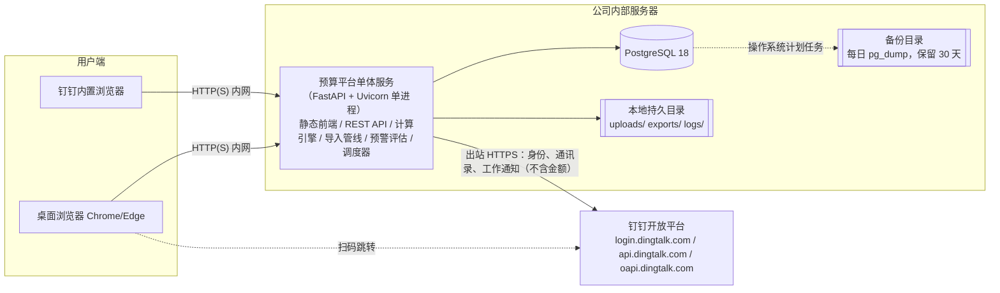

### 2.3 版本核实总表（核实日期 2026-10-27）

「当前稳定版」= 官方来源当日标为 latest / 最新稳定的版本；「建议锁定版」= 本项目脚手架应精确锁定的版本（写入 `uv.lock` / `package-lock.json`），两者不同时给出理由。

| 组件 | 当前稳定版（发布日期） | 建议锁定版 | 许可证 | 核实来源 URL |
| :--- | :--- | :--- | :--- | :--- |
| Python | 3.15.2、3.14.10（均 2026-10-25）；3.15 首发 2026-10-09，3.14 处于 bugfix 维护期，EOL 2030-10 | **3.14.10** | PSF | https://www.python.org/api/v2/downloads/release/ ；https://peps.python.org/api/release-cycle.json |
| FastAPI | 0.162.0（2026-10-23） | **0.162.0** | MIT | https://pypi.org/pypi/fastapi/json |
| Uvicorn | 0.54.0（2026-09-25） | **0.54.0** | BSD-3-Clause | https://pypi.org/pypi/uvicorn/json |
| SQLAlchemy | 2.1.6（2026-10-21），要求 Python ≥ 3.11 | **2.1.6** | MIT | https://pypi.org/pypi/sqlalchemy/json |
| Alembic | 1.20.1（2026-10-22） | **1.20.1** | MIT | https://pypi.org/pypi/alembic/json |
| psycopg（含 psycopg-binary） | 3.3.6（2026-09-18）；已核实提供 cp314 的 win_amd64 与 manylinux x86_64 wheel | **3.3.6** | LGPL-3.0-only（作为未修改的动态库使用，内部部署无传染问题） | https://pypi.org/pypi/psycopg/json ；https://pypi.org/pypi/psycopg-binary/json |
| Pydantic | 2.14.1（2026-10-11） | **2.14.1** | MIT | https://pypi.org/pypi/pydantic/json |
| pydantic-settings | 2.16.1（2026-10-20） | **2.16.1** | MIT | https://pypi.org/pypi/pydantic-settings/json |
| python-calamine | 0.9.0（2026-10-16）；已核实 cp314 Windows/Linux wheel | **0.9.0** | MIT | https://pypi.org/pypi/python-calamine/json |
| openpyxl | 3.1.5（2024-06-28，仍为最新） | **3.1.5** | MIT | https://pypi.org/pypi/openpyxl/json |
| APScheduler | 3.11.3（2026-06-28，PyPI latest 仍为 3.x） | **3.11.3** | MIT | https://pypi.org/pypi/apscheduler/json |
| httpx | 0.28.1（2024-12-06，仍为最新） | **0.28.1** | BSD-3-Clause | https://pypi.org/pypi/httpx/json |
| pytest | 9.1.1（2026-06-19） | **9.1.1** | MIT | https://pypi.org/pypi/pytest/json |
| uv（Python 依赖锁定工具，仅开发/打包用） | 0.13.6（2026-10-27，当天发布） | 0.13.x，以首次生成锁文件时实际使用的补丁版为准并写入 README | MIT/Apache-2.0 | https://pypi.org/pypi/uv/json |
| Node.js（仅构建前端用，不上服务器） | 26.12.1 Current（非 LTS）；24.22.1 LTS「Krypton」（2026-10-20） | **24.22.1 LTS** | MIT | https://nodejs.org/dist/index.json |
| Vue | 3.5.44（latest；3.6 处于 rc） | **3.5.44** | MIT | https://registry.npmjs.org/vue/latest |
| Vite | 8.3.5（要求 Node ^20.19 或 ≥ 22.12） | **8.3.5** | MIT | https://registry.npmjs.org/vite/latest |
| @vitejs/plugin-vue | 6.0.10 | **6.0.10** | MIT | https://registry.npmjs.org/@vitejs/plugin-vue/latest |
| Vue Router | 5.4.0（peer：vue ^3.5.34） | **5.4.0** | MIT | https://registry.npmjs.org/vue-router/latest |
| Pinia | 4.1.0（peer：vue ^3.5.11，typescript ≥ 5.6） | **4.1.0** | MIT | https://registry.npmjs.org/pinia/latest |
| Element Plus | 2.14.7（peer：vue ^3.3.7） | **2.14.7** | MIT | https://registry.npmjs.org/element-plus/latest |
| @element-plus/icons-vue | 2.3.2 | **2.3.2** | MIT | https://registry.npmjs.org/@element-plus/icons-vue/latest |
| RevoGrid（@revolist/revogrid） | 4.29.1（2026-10-23） | **4.29.1** | MIT | https://registry.npmjs.org/@revolist/revogrid/latest ；https://raw.githubusercontent.com/revolist/revogrid/main/LICENSE |
| RevoGrid Vue 3 封装（@revolist/vue3-datagrid） | 4.29.1 | **4.29.1**（与核心同版本） | MIT | https://registry.npmjs.org/@revolist/vue3-datagrid/latest |
| TypeScript | 7.0.2（latest，2026-07-08 发布 7.0） | **6.0.3** —— 理由：vue-tsc 3.3.13 声明 peer `typescript >=5.0.0`，但对 7.x 的实际兼容性本次未能核实；6.0.3 满足 Pinia 的 ≥ 5.6 要求 | Apache-2.0 | https://registry.npmjs.org/typescript |
| vue-tsc | 3.3.13 | **3.3.13** | MIT | https://registry.npmjs.org/vue-tsc/latest |
| dingtalk-jsapi | 3.2.9（2026-04-28，维护者为阿里巴巴/钉钉账号） | **3.2.9** | MIT | https://registry.npmjs.org/dingtalk-jsapi/latest |
| Vitest | 5.0.5（要求 Node ^22.12 / ^24 / ≥ 26） | **5.0.5** | MIT | https://registry.npmjs.org/vitest/latest |
| PostgreSQL | 18（current，latestMinor = 6，即 18.6；EOL 2030-11-14）；EDB Windows 安装器页面已列出 18.6 | **18.6** | PostgreSQL License | https://www.postgresql.org/versions.json ；https://www.enterprisedb.com/downloads/postgres-postgresql-downloads |
| Docker 镜像：postgres | `18.6-bookworm`（Docker Hub 更新于 2026-10-21） | **postgres:18.6-bookworm** | — | https://hub.docker.com/v2/repositories/library/postgres/tags/18.6-bookworm |
| Docker 镜像：python | `3.14.10-slim-bookworm`（Docker Hub 更新于 2026-10-27） | **python:3.14.10-slim-bookworm** | — | https://hub.docker.com/v2/repositories/library/python/tags?name=3.14 |

锁定策略：后端用 `uv.lock`，前端用 `package-lock.json`，全部精确版本；安装包内附带离线 wheel 与已构建前端，生产机不在线解析版本。升级只在补丁版本内进行，且需跑完 §7.4 的检查。

### 2.4 未能核实的事项

| 事项 | 情况 | 影响与处理 |
| :--- | :--- | :--- |
| 钉钉开放平台各接口当前路径与参数 | 本次运行环境无法访问 open.dingtalk.com 文档页（连接返回 000） | §4.6 所列接口路径来自钉钉公开文档的既有知识，开发首周须按官方文档逐一核对；不影响选型 |
| GitHub 仓库元数据（RevoGrid、Jspreadsheet CE 的最近提交、Release 页） | 本会话未开通 GitHub API 访问 | RevoGrid 的维护状态以 npm 2026-10-23 发布 4.29.1 佐证；许可证以 npm `license` 字段与 GitHub raw LICENSE 文件双重核实。Jspreadsheet CE 的 npm `license` 字段为空、无法确认，因此不作推荐 |
| vxe-table 的「区域选取 / 复制粘贴」是否属开源核心 | npm 上只找到第三方插件 `vxe-table-plugin-extend-cell-area` 0.1.0（MIT），官方说明未核实 | 按「需自行实现或付费」计分，不影响推荐结论 |
| TypeScript 7.x 与 vue-tsc 的兼容性 | 未核实 | 锁定 TypeScript 6.0.3 规避 |
| 国内镜像在国内网络下的速度 | 本次核实环境不在国内：阿里云 PyPI 镜像、腾讯云 PyPI 镜像、npmmirror 返回 200 且已同步当日版本（如 fastapi 0.162.0、RevoGrid 4.29.1）；清华 PyPI 镜像在本环境连接失败 | 首选阿里云 PyPI 镜像与 npmmirror；开发首日在公司网络复测一次 |

---

## 3. 前端技术选型

### 3.1 已确认部分：Vue 3 + 中文组件库

蓝图 §8 已确认 Vue 3。中文组件库属于「直接默认」维度：

- **推荐**：Element Plus 2.14.7
- **决策证据**：中文文档与 `zh-cn` 语言包随包提供；表单、抽屉、弹窗、分页、标签页、上传等后台组件齐全，正好覆盖 30 个页面的列表、编辑抽屉与确认弹窗（蓝图 §5）；MIT；按需引入后体积可控；AI 生成 Element Plus 代码的语料充足。
- **当前代价**：Element Plus 自带的 `el-table` 不是电子表格，不能满足整块粘贴、冻结维度列 + 12 个月横向展开的填报体验，所以填报表格另选组件（§3.2）。列表页、报表页仍用 `el-table`。
- **升级触发条件**：若 Element Plus 出现与 Vue 3.5 的阻断性兼容问题且两周内无修复，再评估 Ant Design Vue。

### 3.2 类 Excel 表格组件（需要对比）

用于 PAGE-F04-02/03/04/05、PAGE-F05-01 五个填报页（REQ-F04-01~05、REQ-F05-01，蓝图 §5「类 Excel 表格」）。硬性要求：开源许可可商用于公司内部；维度列冻结；单元格内编辑；从 Excel 整块复制粘贴；虚拟滚动支撑单人最多数千行 × 12 月；在钉钉内置浏览器中可用。

权重（按本期约束调整）：DX 0.20、Perf 0.15、Eco 0.15、AI 0.15、Scale 0.05、Learn 0.10、TCO 0.20（许可证与「是否需要自己实现粘贴」都计入 TCO）。

| 候选 | DX | Perf | Eco | AI | Scale | Learn | TCO | 加权总分 |
| :--- | :---: | :---: | :---: | :---: | :---: | :---: | :---: | :---: |
| RevoGrid 4.29.1（MIT，核心含区域选择、Excel 粘贴、列冻结、虚拟滚动） | 4 | 5 | 3 | 3 | 4 | 4 | 5 | **4.05** |
| AG Grid Community 36.2.0（MIT，但区域选择与剪贴板仅企业版） | 3 | 5 | 5 | 5 | 5 | 3 | 2 | 3.80 |
| vxe-table 4.23.11（MIT 核心，区域复制粘贴需插件或自研） | 3 | 4 | 4 | 4 | 4 | 4 | 2 | 3.40 |
| Univer（@univerjs/presets 1.2.0，Apache-2.0，完整电子表格引擎） | 2 | 3 | 3 | 2 | 3 | 2 | 4 | 2.75 |

**许可证核实结论**：

| 组件 | 许可证 | 证据 | 结论 |
| :--- | :--- | :--- | :--- |
| RevoGrid 核心与 Vue 3 封装 | MIT | npm `license: MIT`；GitHub raw LICENSE 首行「MIT License, Copyright (c) 2024 Revolist OU」；npm README 列明核心含「Excel-like focus」「Seamless copy/paste from Excel」「Range Selection / Range Autofill」「Pinned Columns」「Virtual Scroll」 | ✅ 采用。README 同时列出 RevoGrid Pro（商业）功能：撤销重做、多区域选择、Excel 导入导出等——**本项目不使用任何 Pro 功能**，Excel 导入导出在服务端完成 |
| AG Grid Community | MIT | npm README 功能表：Range Selection、Clipboard Operations 在 Community 列为 ❌、Enterprise 列为 ✅ | 满足需求须购买 Enterprise 或自研剪贴板，不选 |
| Handsontable 18.1.2 | 非开源双许可 | npm `license: SEE LICENSE IN LICENSE.txt`；LICENSE.txt 写明商业用途须遵守商业许可条款，非商业许可仅限个人或评估 | ❌ 排除，不进入候选表 |
| Jspreadsheet CE 5.0.4 | 无法确认 | npm `license` 字段为空，最近发布 2025-08-25，GitHub 元数据本次无法读取 | 不推荐 |

**推荐：RevoGrid 4.29.1（`@revolist/revogrid` + `@revolist/vue3-datagrid`）**（DEC-003，对应 REQ-F04-01、AC-F04-01、AC-F04-02、AC-F04-10、REQ-F05-01、NFR-001、NFR-006）

推荐理由：
1. 唯一在开源核心中同时提供「从 Excel 整块粘贴 + 区域选择 + 冻结列 + 虚拟滚动」的候选，与蓝图 §5 的填报范式一一对应，无需付费或自研剪贴板。
2. MIT，内部部署无许可风险；与 Vue 3 有官方封装包且版本同步发布（均为 4.29.1）。
3. 表格只负责「编辑与展示」，所有计算在服务端（DEC-005），因此不需要 Univer 这类带公式引擎的重型电子表格，避免前后端两套公式不一致。

核心配置建议：
- 路由方案：Vue Router 5，按蓝图 §2 站点地图分组；路由元信息声明所需角色，菜单由后端返回的权限生成（无权限菜单隐藏，蓝图 §2）；路由守卫只是体验层，真正的拦截在服务端（NFR-003）。
- 状态管理：Pinia 4，仅存当前用户、角色、数据范围摘要与全局字典（渠道、店铺、品类等）；表格数据不进全局状态。
- 样式方案：沿用已产出的 `tokens.css` / `app.css` 设计令牌；Element Plus 通过 CSS 变量覆盖主题；系统中文字体，不加载任何外部字体（蓝图 §6）。
- 构建配置：Vite 8；产物输出到后端 `static/` 目录，由 FastAPI 同源托管（DEC-004）；构建目标保持 Vite 默认的「广泛可用基线」，覆盖 Chrome/Edge 当前及前一版与钉钉内置浏览器；`base` 设为根路径；生产构建通过环境变量把开发身份切换入口整段剔除（DEC-013）。
- 数值处理：前端不做金额计算；所有金额与比率在接口中以**字符串**传输，展示格式由后端给定（DEC-005）；比率输入允许「12.5」或「12.5%」，提交前转成字符串原样发送，由后端校验。
- 钉钉免登：`dingtalk-jsapi` 以 npm 包打包，不从任何 CDN 加载。

**次选**：AG Grid Community——若首周最小样例（§8.2 第 2 步）发现 RevoGrid 在钉钉内置浏览器中输入法编辑或粘贴存在不可修复的问题，改用 AG Grid Community，并自研「粘贴事件 → 解析制表符文本 → 批量写入」约 200 行逻辑；不购买 Enterprise。

**不推荐**：
- Handsontable：商业用途需付费许可（LICENSE.txt 原文），公司内部预算系统属于商业用途。
- Univer：完整电子表格引擎自带公式计算，会诱导把 AC-F06 的公式写在前端，与「服务端单一计算源 + 十进制定点」冲突；且它的单元格模型与「月 × 店铺 × 站点 × 品类 × 新老品」的结构化行不匹配，需要大量适配。
- vxe-table：核心免费，但区域复制粘贴官方能力未核实为开源，若要自研则失去对 AG Grid 的优势。

### 3.3 前端组件（CMP）

| ID | 组件 | 职责 | 来源 |
| :--- | :--- | :--- | :--- |
| CMP-F00-01 | 应用外壳 AppShell | 左侧分组侧栏 + 面包屑；按 `/api/me` 返回的权限生成菜单，无权限项隐藏；会话失效统一跳登录页 | 蓝图 §2；AC-F01-01、AC-F01-05 |
| CMP-F01-01 | 登录组件 LoginPanel | 浏览器内跳转钉钉扫码；钉钉内置浏览器内自动调用免登；展示「未开通预算权限，请联系财务负责人」等拒绝原因；仅当 API-F01-01 返回开发开关为真且前端为开发构建时渲染身份切换（DEC-013） | REQ-F01-01、AC-F01-01~03；DEC-002 |
| CMP-F04-01 | 预算表格 BudgetGrid（RevoGrid 封装） | 维度列冻结、12 月横向展开；单元格失焦即保存（调用 API-F04-03，携带基准值）；整块粘贴转为一次批量保存；越界值标红并就地提示允许范围；冲突提示「该数据已被 {姓名} 于 {时间} 修改，请刷新后再改」；按服务端返回的列定义渲染（物流物控只拿到四个比例列）；新渠道超放量单元格标注 | AC-F04-01~06、AC-F04-10、AC-F01-09、AC-F13-02、AC-F06-08、NFR-001 |
| CMP-F09-02 | 导入与错误清单 ImportResultPanel | 上传进度、轮询校验状态、错误行号/字段/原因列表、覆盖确认弹窗；复用于 SKU 对照表、填报模板、金蝶、BI 导入 | AC-F02-03、AC-F04-08、AC-F09-01/03/05 |
| CMP-F10-01 | 达成条 AchievementBar | 细横条表示实际 ÷ 预算，竖刻度表示时间进度（蓝图 §6 设计签名） | AC-F10-02、AC-F10-07 |
| CMP-F14-01 | 导出按钮 ExportButton | 以当前页面的筛选条件调用 API-F14-01，下载服务端生成的 .xlsx | AC-F14-01 |

### 3.4 风险与缓解
- 风险：RevoGrid 的社区语料少于 AG Grid，AI 生成代码出错率可能更高 → 缓解：只在 CMP-F04-01 一个组件里使用 RevoGrid，五个填报页都复用它；首周用最小样例验证粘贴、冻结、输入法、2 万行滚动四项。
- 风险：钉钉内置浏览器内核版本落后 → 缓解：首周在钉钉 Windows 版与 macOS 版内置浏览器各打开一次最小样例；构建不使用尚未广泛可用的语法与 API。
- 风险：TypeScript 锁 6.0.3 而非最新 7.x → 缓解：不影响运行时；待 vue-tsc 明确支持 7.x 后再评估升级。

---

## 4. 后端技术选型

### 4.1 已确认：Python + FastAPI（直接默认的细化）

蓝图 §8 已确认后端为 Python + FastAPI，不再做候选对比。以下为落地选择：

| 项 | 推荐 | 决策证据 | 当前代价 | 升级触发条件 |
| :--- | :--- | :--- | :--- | :--- |
| Python 运行时 | 3.14.10 | 3.14 进入 bugfix 维护期一年，全部依赖已核实提供 cp314 Windows 与 Linux wheel；3.15 首发不足三周 | 不用 3.15 新特性 | 3.15 出到 3.15.3+ 且依赖齐全时可升 |
| ASGI 服务 | Uvicorn 0.54.0，**单进程单 worker** | 150 人内部工具，峰值并发很低；单进程让进程内调度器不会重复执行定时任务（DEC-004） | 单核上限；CPU 密集操作（导入解析）需放线程池 | 实测 P95 超 NFR-001 或峰值并发 > 200 时，改多 worker 并把调度器拆成独立进程 |
| 数据访问 | SQLAlchemy 2.1.6（同步会话）+ psycopg 3.3.6 | 同步代码对 AI 与新人最直观；FastAPI 会把同步路由放进线程池执行；psycopg 3 提供 COPY 批量写入，导入 5 万行用得上 | 同步路由占用线程池线程 | 线程池成为瓶颈时再迁移异步会话 |
| 迁移 | Alembic 1.20.1 | SQLAlchemy 官方迁移工具；首次部署即通过迁移建表和预置三条规则（AC-F12-03） | 无 | — |
| 配置 | pydantic-settings 2.16.1 | 环境变量 / `.env` 读取并强类型校验；启动时校验生产配置（DEC-013） | 无 | — |
| Excel 读取（DEC-017，对应 NFR-002、AC-F09-01/05） | python-calamine 0.9.0 | Rust 内核，读取 xlsx/xls 远快于 openpyxl，支撑 NFR-002；金蝶导出可能是 .xls，calamine 两种都能读 | 只读不写 | — |
| Excel 写出（DEC-017，对应 AC-F04-07、AC-F14-01） | openpyxl 3.1.5（write-only 模式） | 生成填报模板（AC-F04-07）与导出（AC-F14-01）；write-only 模式内存占用低 | 2024 年后无新版本，但仍是 Python 写 xlsx 的事实标准 | 出现阻断性缺陷时换 XlsxWriter |
| 定时与重试 | APScheduler 3.11.3（进程内 BackgroundScheduler，时区 Asia/Shanghai） | 通知重试、逾期提醒、通讯录同步三个任务，规模不需要队列 | 进程重启时进行中的任务靠数据库状态恢复（发件箱表） | 拆多进程部署时改用数据库锁保证单实例执行 |
| 出站 HTTP | httpx 0.28.1，封装为只允许钉钉域名的客户端 | NFR-005 要求不向公司外发数据；白名单在代码层强制 | 无 | — |
| 测试 | pytest 9.1.1 | 计算公式、权限、导入、状态机以单元/集成测试覆盖 | 无 | — |

不引入：Redis、消息队列、Celery、独立认证服务、ORM 之外的查询层。

### 4.2 后端模块（CMP）

| ID | 模块 | 职责 | 来源 |
| :--- | :--- | :--- | :--- |
| CMP-F01-02 | 认证与会话 auth | 钉钉扫码回调、H5 免登、会话签发与 8 小时无操作失效、每次请求校验用户启用状态与角色 | REQ-F01-01、AC-F01-01~03、蓝图 §9 |
| CMP-F01-03 | 数据范围过滤 scope | 由当前用户的角色与范围生成查询条件；按角色选择响应模型（字段级）；越权统一抛「无权限」 | REQ-F01-03、AC-F01-06~11、NFR-003、AC-F14-01 |
| CMP-F06-01 | 计算引擎 calc | 纯函数实现 AC-F06-01~09、AC-F10-03/04/08/09/10、AC-F05-02 历史参考、AC-F02-04 新老品；保存时增量重算 | REQ-F06-01/02、REQ-F10-02/05、NFR-001 |
| CMP-F04-02 | 填报服务 filling | 单元格保存（取值范围校验 + 单元格级乐观锁）、填充全年、模板生成与上传、提交锁定、新渠道放量校验 | REQ-F04-01~05、REQ-F05-01/02、REQ-F13-01 |
| CMP-F07-01 | 审批流服务 approval | 填报单位、编制任务、目标调整、规则版本的状态迁移；退回原因校验；触发通知 | REQ-F07-01/02、REQ-F08-01、REQ-F12-02 |
| CMP-F08-01 | 版本服务 version | 版本复制、锁定、调整月份限制、滚动预测快照生成、版本对比 | REQ-F08-01~03、AC-F07-05 |
| CMP-F09-01 | 导入管线 importer | 上传存档 → 解析 → 校验 → 暂存 → 确认入库（含覆盖）→ 归集 → 核对 → 触发预警评估 | REQ-F09-01/02、REQ-F02-02、REQ-F04-04、NFR-002 |
| CMP-F11-01 | 预警评估器 alerting | 只取生效规则版本，对受影响月份计算指标、判断连续月数、upsert 预警记录 | REQ-F11-01、AC-F12-05 |
| CMP-F11-02 | 钉钉网关与通知发件箱 dingtalk | access_token 缓存、通讯录同步、工作通知发送、失败重试与「通知失败」标注、内容白名单 | REQ-F11-02、AC-F03-01/04、AC-F07-01/03、AC-F08-05、NFR-005 |
| CMP-F00-02 | 审计记录器 audit | 在业务事务内写入只追加审计行（操作人、时间、对象、前值、后值） | NFR-004 |
| CMP-F00-03 | 调度器 scheduler | 每分钟扫描发件箱；每日 09:00 逾期检查；每 10 分钟通讯录增量同步 | AC-F11-05、AC-F03-04、AC-F01-03 |
| CMP-F14-02 | 导出服务 exporter | 复用各报表查询（已带范围过滤）生成 .xlsx，列定义与页面一致 | REQ-F14-01、AC-F14-01、NFR-003 |
| CMP-F02-01 | 主数据服务 masterdata | 渠道/店铺、B 端客户、部门、预算科目清单（新增、改名、停用，不删除）、科目映射、汇率（预算汇率随原始目标冻结、改汇率触发重算）、SKU 对照表增改；名称唯一校验 | REQ-F02-01~05、AC-F02-01~12；DEC-020、DEC-021 |
| CMP-F03-01 | 编制任务服务 tasking | 发布任务时按 AC-F03-05 生成填报单位并指派填报人/审核人；提交率与逾期统计；目标调整发起时按同一规则生成调整单位 | REQ-F03-01/02、AC-F03-01~05、AC-F08-01~04；DEC-022、DEC-026 |

### 4.3 计算引擎（CMP-F06-01）

**DEC-005 十进制定点**（对应 AC-F06-09、REQ-F06-01/02）：
- 后端所有金额、单价、比率使用 Python `decimal.Decimal`（默认 28 位有效数字上下文），数据库使用 `NUMERIC`；全链路禁止 `float`。Pydantic 模型的金额字段声明为 Decimal 并以字符串序列化。
- 列精度：比率 `NUMERIC(9,6)` 存小数形式（12.3456% 存 0.123456）；平均单价、平均销量 `NUMERIC(18,4)`；SPU 数量 `INTEGER ≥ 0`；本币与人民币派生金额 `NUMERIC(20,6)`（保留未舍入值）；汇率 `NUMERIC(12,6)`。
- 舍入只发生在「显示与导出」：`ROUND_HALF_UP` 到 2 位。合计 = 先对未舍入明细求和、再舍入。由此 |舍入后合计 − Σ舍入后明细| ≤ 0.005 × n + 0.005 ≤ 0.01 × n（n ≥ 1），满足 AC-F06-09。
- 前端不计算任何金额，只展示后端返回的已格式化字符串（DEC-005 同时约束前端）。

**DEC-006 派生值持久化 + 保存时同步增量重算**（对应 NFR-001、AC-F06-01~07）：驱动值保存时，在同一事务内只重算受影响的预算单元并把派生值写回单元行；页面合计用 SQL `SUM` 在该填报单位范围内即时聚合（≤ 20,000 行，毫秒级）。比率类输入（采购成本占比、物流四项、库存索赔率、其他运营费用率）作用于多个单元，按其维度批量重算（单次最多数百至数千行）。理由：保存时计算可让报表、导出、版本对比都直接读派生列，不在每次查询时重算；数据量小，不需要缓存。

**公式与 AC 对应**（平台渠道单元；B 端按客户同式）：

| 输出 | 公式 | 输入来源 | AC |
| :--- | :--- | :--- | :--- |
| 销量 | SPU 数量 × 单 SPU 平均销量 | 运营（DATA-F04-01） | AC-F06-01 |
| 收入（本币） | 销量 × 平均单价 × (1 − 折扣率) | 运营 | AC-F06-01 |
| 人民币收入 | 收入（本币）× 预算汇率（币种 = 店铺结算币种，年度 = 版本年度） | DATA-F02-05 | AC-F06-02、AC-F02-06 |
| 退款、佣金、推广费用 | 人民币收入 × 退款率 / 佣金率 / 广告费率 | 运营 | AC-F06-03 |
| 采购成本 | 人民币收入 × 采购成本占比（月 × 渠道 × 站点 × 品类） | 财务BP（DATA-F04-02） | AC-F06-03、AC-F04-04 |
| 头程、尾程、关税、仓储 | 人民币收入 × 对应费率（月 × 渠道 × 站点 × 品类） | 物流物控（DATA-F04-02） | AC-F06-03、AC-F04-05 |
| 库存索赔、其他运营费用 | 人民币收入 × 对应费率（月 × 渠道 × 站点，适用全部品类与新老品） | 财务BP（DATA-F04-03） | AC-F06-03、AC-F04-11 |
| 毛利 | 人民币收入 − 退款 − 采购成本 − 佣金 − 推广费用 − 头程 − 尾程 − 关税 − 仓储 + 库存索赔 − 其他运营费用 | 派生 | AC-F06-04 |
| 毛利率 | 毛利 ÷ 人民币收入；人民币收入 = 0 时为空值，前端显示「—」 | 派生 | AC-F06-04 |
| B 端人民币收入 | 销售额（本币）× 预算汇率；其余同上，比率来自 B 端业务（退款、推广、其他运营、平台佣金、库存索赔）、财务BP（采购成本占比，月 × 客户）、物流物控（四项，月 × 客户） | DATA-F04-04 | AC-F06-05、AC-F04-03 |
| 公司净利润（月） | Σ平台渠道毛利 + ΣB 端毛利 − Σ部门费用（含专项） + 公司层其他损益（损失为负） | DATA-F05-01、DATA-F05-02、DATA-F06-01 | AC-F06-06、AC-F06-07、AC-F05-03 |
| 双币 | 所有渠道、店铺、B 端客户收入同时返回本币金额（带币种代码）与人民币金额 | — | AC-F06-08 |
| 量差 / 价差 / 汇率差 | (实际销量 − 预算销量) × 预算净单价 × 预算汇率；(实际净单价 − 预算净单价) × 实际销量 × 预算汇率；实际本币收入 × (实际汇率 − 预算汇率)；净单价 = 平均单价 × (1 − 折扣率)；**实际汇率 = 该币种该月的当月平均汇率**（DATA-F02-05 `fx_actual`）；缺当月平均汇率时汇率差与口径差返回空值并附「缺少 YYYY-MM 汇率」 | BI 归集（DATA-F09-04）、当月平均汇率 | AC-F10-03、AC-F02-08 |
| 口径差（DEC-024） | 金蝶实际人民币收入 − BI 实际本币收入 × 当月平均汇率；恒等式：量差 + 价差 + 汇率差 + 口径差 = 收入差额（金蝶实际 − 预算人民币收入） | 金蝶（DATA-F09-03）、BI（DATA-F09-04） | AC-F10-03、AC-F10-05（BI 未到时不计算，拆分区域隐藏） |
| 品效（DEC-025） | 预算品效 = 单 SPU 平均销量 × 平均单价 × (1 − 折扣率)；实际品效 = 实际销售额（本币）÷ 实际 SPU 数；SPU 数 = 0 时为空值显示「—」。单元级（单一店铺站点、单一币种）按本币；品类 × 新老品汇总行跨币种，按人民币口径 Σ(销量 × 净单价 × 汇率) ÷ ΣSPU 数（预算用预算汇率、实际用当月平均汇率）；SPU 数跨店铺站点累加 | 运营驱动、BI 归集 | AC-F10-06 |
| 费率差 | (实际费率 − 预算费率) × 实际人民币收入；实际费率 = 实际费用 ÷ 实际人民币收入 | 金蝶 / BI 实际 | AC-F10-04 |
| 净利润达成率 | Σ(1 月 … 最近导入金蝶月) 实际净利润 ÷ Σ(同期月份) 目标净利润，分别对年初原始目标与最新调整后目标（无调整时两口径相同）；分母 ≤ 0 时返回空值，前端显示「—」；工作台（API-F00-01）与公司汇总（API-F10-01）共用同一函数 | — | AC-F10-08 |
| 新渠道放量（DEC-023） | 店铺月人民币收入 = Σ该店铺该月全部站点 × 品类 × 新老品单元的人民币收入；k = 该月 − 新渠道起始月 + 1（1 ≤ k ≤ 12）；超出 = 店铺月人民币收入 > 生效的「新渠道放量上限」额度标准规则第 k 个月上限；无生效版本时不标注 | DATA-F04-01、DATA-F12-02、DATA-F02-01 | AC-F13-01、AC-F13-02 |
| 版本对比 | 每个维度组合返回两版本的人民币收入、毛利及差额；净利润只在公司合计行计算（含部门费用与公司层其他损益，不分摊到维度） | DATA-F04-01、DATA-F04-04、DATA-F05-01、DATA-F06-01 | AC-F08-08 |
| 增速对比 | 部门费用合计、收入合计各自相对上年同期增速，费用增速 > 收入增速标红 | 历史导入 | AC-F10-09 |
| 季度预测偏差 | \|快照预测净利润率 − 实际净利润率\|（百分点），> 1.5 标红 | DATA-F08-02 | AC-F10-10 |
| 额度使用率 / 时间进度 | 累计实际 ÷ 全年预算；最近导入月份数 ÷ 12 | — | AC-F10-07 |
| 历史参考 | 上年同月实际；最近 12 个已导入月份实际合计；无则「无历史数据」 | DATA-F09-03 | AC-F05-02、AC-F05-04 |
| 新老品 | 该月最后一天 < 首次上架日期 + 12 个月 → 新品，否则老品 | DATA-F02-04 | AC-F02-04 |
| 新渠道期 | 起始月 ≤ 该月 < 起始月 + 12 个月 → 新渠道 | DATA-F02-01 | AC-F13-01 |

**输入校验**（AC-F04-02）：SPU 数量为 ≥ 0 的整数；平均销量、平均单价 ≥ 0；所有比率 0%–100%。不通过时返回字段允许范围，单元格不保存。

**revision 3 新增计算决策**：
- **DEC-023 新渠道放量上限 = 额度标准类规则的 1–12 月逐月上限**（design-derived 形式，对应 AC-F13-02、AC-F12-04）：规则内容 JSONB `{"kind":"new_channel_ramp","unit":"CNY/店铺/月","limits":[m1,…,m12]}`，数值由财务负责人填写，初始可信度「未验证经验」，按额度标准类经财务负责人 + CEO 审批后生效。CMP-F04-02 在单元格保存后按上式重算该店铺该月是否超出，超出时该店铺该月全部单元带 `over_limit = true`；提交前置校验要求每个超出的「店铺 × 月」已填理由（API-F04-08）。规则新版本生效后，对未提交单位即时重判，已提交单位不受影响。
- **DEC-024 收入偏差拆分单列「口径差」**（design-derived，对应 AC-F10-03/05）：金蝶与 BI 收入口径不一致时，量价汇率三项之和不等于收入差额；单列口径差使拆分可加总、可核对，不改变三项公式。
- **DEC-025 品效跨币种汇总按人民币**（design-derived，对应 AC-F10-06）：本币不能跨店铺相加，汇总行改用人民币口径；单元级仍按 AC 的本币公式。
- **金额边界**（处置默认）：清空单元格按 0 保存；部门费用 ≥ 0；B 端销售额 ≥ 0（与 AC-F04-02 同一越界提示机制）。

**测试要求**：每一行公式对应一个以真实中文样例数据驱动的单元测试（例如「Amazon 美国站 · 浴室柜 · 新品 · 2027-03」），断言值精确到 Decimal。

### 4.4 导入校验流程（CMP-F09-01）

**DEC-008 两段式导入**（对应 AC-F09-01~07、AC-F02-03、AC-F04-08、AC-F11-01、NFR-002）：

1. **上传存档**：原文件写入 `uploads/{年}/{月}/{批次ID}.{扩展名}`，记录文件名、大小、SHA-256、上传人、上传时间，批次状态 = 校验中（DATA-F09-01）。前端获得批次 ID 后每 2 秒轮询 API-F09-02。
2. **解析**（线程池中执行，不阻塞其他请求）：python-calamine 流式读取，按模板表头定位列；表头不符直接失败。
3. **校验**：开场一次性把主数据载入内存字典（店铺、站点、部门、科目映射、SKU 对照表），逐行检查：期间格式、部门/店铺/站点存在、金蝶科目已映射、SKU 已映射、数值格式；**收集全部错误**（行号、问题类型、涉及编码或名称），不在第一个错误处停止。
4. **结果**：
   - 有错误 → 批次状态 = 校验失败，返回错误清单；**不写入任何业务数据**（AC-F09-01、AC-F09-05）。
   - 无错误 → 用 psycopg COPY 把解析行写入暂存表，批次状态 = 待确认；若该来源该期间已有生效批次，返回「需确认覆盖」及旧批次信息（AC-F09-03）。
5. **确认入库**（API-F09-03，单一数据库事务）：
   - 旧生效批次标为「已被替换」并记录替换批次，其行数据保留但不再参与计算（蓝图 §9「导入覆盖保留旧记录」）；
   - 暂存行转入实际数表；金蝶行带客户辅助核算且客户在 B 端客户主数据中时记入该客户（供 AC-F10-12 的 B 端行），其余无店铺核算且非部门费用科目的成本/费用行计入「未归属渠道」（AC-F09-02）；BI 行按 SKU → SPU → 品类与 AC-F02-04 归集到「月 × 店铺 × 站点 × 品类 × 新老品」（AC-F09-06）；
   - 重算 BI 与金蝶核对差异率（AC-F09-07）；
   - 调用预警评估器对受影响月份评估并写入预警记录与通知发件箱（AC-F11-01/02，SEQ-F09-01）；
   - 写审计日志（NFR-004）；
   - 提交事务后，调度器在 1 分钟内发送通知。
6. **历史导入**（AC-F09-04）：同一模板，一份文件含最多 24 个期间；校验通过后按期间拆成多个逻辑批次逐月入库，复用以上覆盖规则。
7. **BI 双月导入校验与覆盖**（AC-F09-05、AC-F09-08、AC-F09-09）：BI 文件逐行检查月份格式（`YYYY-MM`）、店铺与站点存在于主数据且站点属于该店铺（停用店铺照常接受，AC-F02-10）、SKU 在对照表中；任一行不通过 → 整份校验失败，错误清单含行号、问题类型（`month_format` / `store_not_found` / `site_not_found` / `sku_unmapped`）与涉及名称，未映射 SKU 另去重汇总列出。一份 BI 文件可含多个月份：按月份拆为逻辑批次；文件内任一月份已有生效 BI 批次即返回「需覆盖确认」并列出这些月份及旧批次文件名、导入人、导入时间；确认后在同一事务内把这些月份的旧 BI 批次全部标为「已被替换」（行保留），未确认则不写入。
8. **BI 与金蝶核对**（AC-F09-07、AC-F02-08）：按「月 × 店铺 × 站点」，BI 折人民币 = BI 本币销售额 × 该币种当月平均汇率；差异率 =（BI 折人民币 − 金蝶收入）÷ 金蝶收入；|差异率| > 3% 标红。缺当月平均汇率的组合不计算，返回「缺少 YYYY-MM 汇率」；金蝶收入 = 0 时差异率为空值显示「—」。当月平均汇率在导入后才补录时，保存汇率即重算该月核对与汇率差（同事务）。

同一流程复用于：SKU 对照表整表上传（AC-F02-03，规则见下）、填报模板上传（AC-F04-08，校验通过后批量写入填报值并触发重算）。

**DEC-021 SKU 对照表按 SKU 增改、不删除；SPU 上架日期取最早**（design-derived，对应 AC-F02-03、AC-F02-04）：
- 校验（任一行不通过整份拒绝）：SKU、SPU 编码、品类、首次上架日期任一缺失（AC-F02-03）；日期格式错误；文件内 SKU 重复；品类不在品类清单；同一 SPU 在文件内出现不同品类（SPU → 品类必须唯一）。
- 入库：文件中的 SKU 按 SKU 编码 upsert（新增或更新所属 SPU、品类、上架日期），文件中未出现的旧 SKU 保留不删；SPU 首次上架日期 = 其下全部 SKU 上架日期的最小值，在同一事务内重新派生。
- 已归集的 BI 实际（DATA-F09-04 归集表）不因对照表修改而回改，修改只影响之后的导入（与科目映射同一原则，AC-F02-05）。

启动时把状态仍为「校验中」的批次标为「校验中断，请重新上传」，避免重启后悬挂。

**性能估算**（NFR-002）：calamine 读 5 万行为秒级；内存字典校验为线性；COPY 写入 5 万行为秒级；整体预计远低于 60 秒，由 §1.4 测量点验证。

### 4.5 权限在服务端过滤（CMP-F01-03）

**DEC-009 统一范围过滤 + 字段级响应模型 + 路由全覆盖检查**（对应 REQ-F01-03、AC-F01-04~11、NFR-003、AC-F14-01）：
- **角色与范围数据**：用户可有多个角色；范围分三类——部门、渠道/店铺、B 端客户（DATA-F01-02）。CEO、财务负责人、财务BP 为全公司范围（AC-F01-10）。
- **每次请求重新加载**当前用户的角色与范围（不缓存在会话中），因此财务负责人保存分配后，员工下一次请求即按新范围生效（AC-F01-04）。
- **列表与报表查询**：仓储层所有查询函数都必须接收 `ScopeContext`，由它为 SQL 追加 `WHERE` 条件（部门 ID ∈ 范围 / 店铺 ID ∈ 范围 / B 端客户 ID ∈ 范围）。导出复用同一查询函数，因此导出天然只含范围内的行（AC-F14-01）。
- **详情与写操作**：先按 ID 取记录，再判断是否在范围内；不在范围内返回 HTTP 403，响应体只有 `{"code":"forbidden","message":"无权限"}`，不含任何记录字段（AC-F01-11）。
- **字段级**：物流物控请求填报数据时使用只含维度列与四项物流比例的响应模型和列定义，收入与利润字段在序列化前就不存在（AC-F01-09）；模板下载同理（AC-F04-07）。
- **功能级**：角色分配接口仅财务负责人（AC-F01-05）；导入仅财务BP；规则审批仅财务负责人/CEO 等，用路由依赖声明。基础数据各接口：财务BP 读写（新渠道标记仅财务负责人，AC-F13-01），CEO 与财务负责人只读，其他角色 403。
- **DEC-019 首位财务负责人与至少保留一名**（design-derived，对应 AC-F01-05、REQ-F01-02）：
  - 首位财务负责人由部署配置 `BOOTSTRAP_FINANCE_HEAD_USERID`（钉钉 userid，deployment-config，非密钥）指定；应用启动时若系统内没有任何启用的财务负责人，则为该 userid 建立本地用户并授予「财务负责人」，写审计（操作人 = `system-bootstrap`）；已存在财务负责人时该配置不生效（幂等），不能借此覆盖已有分配。
  - API-F01-07 保存角色时，若结果会使启用状态的财务负责人数量变为 0（包括撤销自己的最后一个财务负责人角色），返回 409 `{"code":"last_finance_head","message":"系统至少需要保留一名财务负责人"}`，不写入。
  - 通讯录同步把最后一名财务负责人停用时无法阻止：写错误日志，`/api/health` 返回 `finance_head_missing` 告警，由信息数字化部更新 `BOOTSTRAP_FINANCE_HEAD_USERID` 并重启恢复。
- **全覆盖检查**：自动化测试遍历 FastAPI 路由表，断言除登录、健康检查外的每个路由都挂了认证依赖与权限声明；新增路由未声明即测试失败。

### 4.6 钉钉对接（CMP-F11-02、CMP-F01-02）

凭据：AppKey、AppSecret、AgentId、CorpId 属于 deployment-secret，由信息数字化部在部署时写入服务器环境变量（或 `.env`，文件权限仅服务账号可读）；不入代码库、不入安装包、不入日志。凭据轮换时由信息数字化部更新配置并重启服务（requirements「External capability configuration」）。

> 以下接口路径基于钉钉开放平台公开文档的既有知识，本次未能在线核对（§2.4），开发首周按官方文档逐一确认。

| 能力 | 方式 | 关键接口（以官方文档为准） | 对应 |
| :--- | :--- | :--- | :--- |
| 企业凭证 | 用 AppKey/AppSecret 换 access_token（有效期约 2 小时），进程内缓存并提前刷新 | `POST https://api.dingtalk.com/v1.0/oauth2/accessToken` | 全部 |
| 浏览器扫码登录 | OAuth2：登录页跳转钉钉授权页，回调带 `authCode`，服务端换用户 token 并取 unionId，再换企业内 userid | `https://login.dingtalk.com/oauth2/auth`；`POST /v1.0/oauth2/userAccessToken`；`GET /v1.0/contact/users/me`；`topapi/user/getbyunionid` | REQ-F01-01、AC-F01-01 |
| 工作台免登 | 钉钉内置浏览器内由前端 `dingtalk-jsapi` 取免登授权码，服务端换 userid | 前端 `requestAuthCode({corpId})`；服务端 `topapi/v2/user/getuserinfo` | REQ-F01-01、AC-F01-01 |
| 用户状态与通讯录 | 登录时实时取用户详情；每 10 分钟增量同步、每日 02:00 全量同步，离职/停用用户标为停用 | `topapi/v2/user/get`、`topapi/v2/user/list`、`topapi/v2/department/listsub` | AC-F01-02、AC-F01-03、PAGE-F01-02 员工列表 |
| 工作通知 | 以应用身份异步发送给 userid 列表；消息为「链接」类型，只含标题、规则/任务名称、对象、期间、系统链接 | `topapi/message/corpconversation/asyncsend_v2` | AC-F03-01、AC-F03-04、AC-F07-01、AC-F07-03、AC-F08-05、AC-F11-04 |

**DEC-011 通知发件箱 + 重试 + 内容白名单**（对应 AC-F11-04、AC-F11-05、NFR-005）：
- 业务事务内只向发件箱表（DATA-F11-02）插入「待发送」记录，不直接调钉钉，保证业务提交与通知意图一致。
- 调度器每分钟取 `next_attempt_at ≤ 现在` 的记录发送：成功 → 已发送；失败（网络错误、HTTP 非 200、或返回 errcode ≠ 0）→ 尝试次数 +1，`next_attempt_at = 现在 + 5 分钟`；首次发送后最多重试 3 次，第 4 次仍失败 → 状态「失败」，若业务类型为预警则把预警记录的通知状态标为「通知失败」（AC-F11-05）。
- 内容由类型化模板生成，模板参数只接受：标题、规则或任务名称、对象名称、期间、链接。构造器拒绝任何 Decimal / 数值金额参数；单元测试断言（NFR-005）。
- 出站 HTTP 客户端只允许 `api.dingtalk.com`、`oapi.dingtalk.com` 两个主机，其他主机直接抛错（NFR-005）。

**DEC-012 停用账号的识别**（对应 AC-F01-03）：每次请求都检查本地用户的启用状态与会话；本地状态来自「登录时实时校验 + 每 10 分钟增量同步」。因此「已有会话在下一次请求时失效」在系统得知停用后立即生效，**得知的延迟上限约 10 分钟**。若验收要求零延迟，需要信息数字化部为应用开通通讯录事件订阅（钉钉推送离职事件），这是新增权限，列为待确认（§8.4）。

**服务器网络前提**：公司内部服务器须能出站访问 `*.dingtalk.com:443`；用户浏览器须能访问 `login.dingtalk.com`（扫码页）。由信息数字化部在部署前确认。

### 4.7 审计日志（CMP-F00-02）

**DEC-010 只追加审计表**（对应 NFR-004、REQ-F01-02、REQ-F07-02、REQ-F08-01、REQ-F09-01、REQ-F12-02）：
- 覆盖范围：角色与范围分配、目标版本锁定与 CEO 审批、目标调整（发起、提交、各级审批、生效）、导入（上传、确认、覆盖）、规则库（新建、修改、提交、审批、生效/转历史）。另记录登录成功/拒绝（便于排查，非 NFR 强制）。
- 字段：操作时间（带时区）、操作人 userid 与姓名快照、操作类型、对象类型与 ID、修改前值与修改后值（JSONB）、请求 ID、来源 IP、认证来源（钉钉 / 开发模拟）。
- 写入与业务修改在**同一数据库事务**内完成，业务成功则审计必在。
- 不可删除：应用数据库账号对审计表只授予 `INSERT, SELECT`；另加 `BEFORE UPDATE OR DELETE` 触发器直接报错，防止误用超级账号。保留期：本期不做任何清理任务（≥ 3 年即「不删」）。
- 查看：本期无审计查看页（蓝图 §9），由技术人员按时间段与对象导出为 Excel（提供一个仅命令行可用的导出脚本，不暴露 HTTP 接口）。

### 4.8 状态机

#### 4.8.1 填报单位（DATA-F03-02；AC-F03-03、AC-F03-05、AC-F04-09、AC-F07-01~06）

**填报单位生成规则**（AC-F03-05，CMP-F03-01，SEQ-F03-01）：发布任务时在同一事务内生成——

| 单位类型 | 粒度 | 填报人 | 审核人（部门负责人） |
| :--- | :--- | :--- | :--- |
| 平台渠道 | 每个**启用**店铺一个（停用店铺不生成，AC-F02-10） | 数据范围覆盖该店铺（或其渠道）的运营 | 填报人所属部门负责人 |
| B 端 | 每个负责部门一个（美国业务部、外贸部；含该部门全部启用客户） | 数据范围覆盖该部门客户的 B端业务 | 该负责部门负责人 |
| 成本比例 | 一个 | 财务BP | 财务BP 所属部门负责人 |
| 物流比例 | 一个 | 物流物控 | 物流物控所属部门负责人 |
| 部门费用 | 每个参与部门一个（只含启用预算科目） | 该部门的部门预算专员 | 该部门负责人 |

- 唯一约束 `(task_id 或 adjustment_id, unit_type, scope_object_id)`；每个单位独立提交、审核、退回。
- 不变量：任一生成的单位没有填报人或没有审核人时，整个发布失败并返回 422，列出缺人的单位名称，不生成任何单位、不发通知。
- **DEC-026 提交率口径**（design-derived，对应 AC-F03-03）：提交率 =（已提交 + 已通过）单位数 ÷ 全部单位数；已退回不计入；API-F03-02 与工作台共用一个 SQL 聚合。

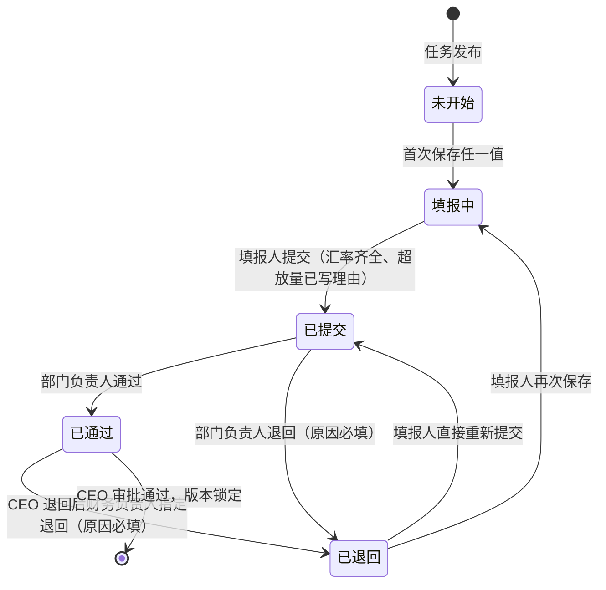

- 合法编辑：仅「未开始 / 填报中 / 已退回」可写；「已提交 / 已通过」任何人写入返回「已提交，退回后才能修改」（AC-F04-09）。
- 非法迁移示例：未开始 → 已通过；已提交 → 填报中（必须经退回）；任务已锁定后任何迁移。
- 并发：状态迁移用 `UPDATE … WHERE id = ? AND status = 期望状态`，影响行数为 0 时返回「状态已变化，请刷新」；提交与单元格保存竞争时，以状态条件更新串行化。
- 提交前置校验：涉及币种均有预算汇率（AC-F02-07）；新渠道超放量单元格均已填理由（AC-F13-02）。

#### 4.8.2 编制任务与预算版本（DATA-F03-01、DATA-F08-01；AC-F03-02、AC-F07-04~06、AC-F08-01~09）

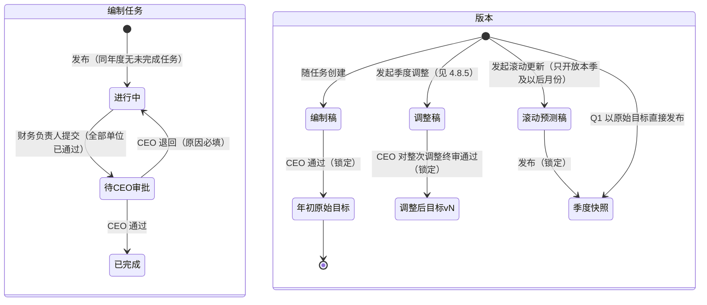

- 锁定版本（年初原始目标、调整后目标 vN、季度快照）不可修改：服务层拒绝 + 数据库触发器拒绝对 `locked = true` 版本下的单元行 UPDATE/DELETE（AC-F07-05、AC-F08-04、AC-F08-07）。
- 调整稿只允许编辑尚无金蝶实际的月份（AC-F08-02）；同一自然季度已有通过的调整时禁止发起（AC-F08-01），用「年度 + 季度」唯一约束兜底并发。
- 调整稿与滚动预测稿是两个独立版本，互不覆盖（PRD §3.3.8）。同一季度滚动更新只能发起一次（部分唯一索引 `(year, quarter) WHERE type = 滚动预测稿`）；发布快照时仍有未提交单位，接口返回这些单位名单供确认弹窗列出，确认后按其最近一次提交的数值计算（从未提交则取来源版本数值）。
- **DEC-020 预算汇率随年初原始目标冻结**（对应 AC-F02-11、AC-F02-06）：CEO 通过使编制稿 → 年初原始目标的同一事务内，该年度视为「汇率已锁定」（判定条件：存在该年度 `type = 年初原始目标` 的版本，不另存状态避免双份真相）。API-F02-05 对已锁定年度的任何预算汇率新增或修改返回 409 `{"code":"fx_locked","message":"已随年初原始目标锁定"}`；`fx_budget` 另加 `BEFORE INSERT OR UPDATE OR DELETE` 触发器做同一判定，防止绕过服务层。锁定前修改预算汇率时，同一事务内对该年度全部未锁定版本中该币种的单元重算派生值（≤ 2 万行，秒级），保证 AC-F06-02 与已保存派生值一致。调整后目标与滚动预测沿用冻结后的预算汇率。
  - revision 4 补充（AC-F02-11）：锁定只禁止**修改或删除已有币种**的预算汇率；该年度尚无预算汇率的币种允许**新增一次**（INSERT 放行、UPDATE/DELETE 拒绝），新增后用于滚动预测与季度调整，审计日志记录（NFR-004）。

#### 4.8.3 规则版本（DATA-F12-02；AC-F12-01、AC-F12-04~06）

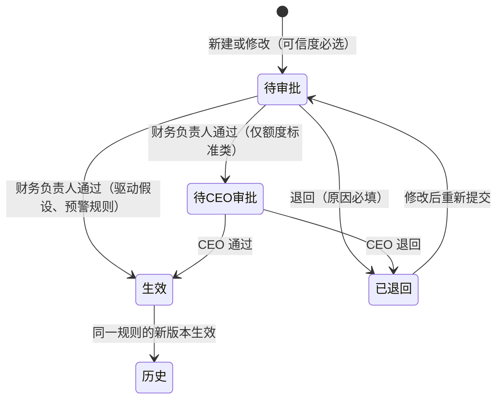

- 每条规则同一时刻最多一个生效版本：部分唯一索引 `(rule_id) WHERE status = '生效'`；新版本生效与旧版本转历史在同一事务。
- 「已退回」对应 AC-F12-07（revision 3 起有需求来源）：退回原因为空返回 422「请填写退回原因」；已退回版本不生效、不参与评估，原因写入 DATA-F07-01 并在规则详情向提交人显示。提交人修改后重新提交生成**新的待审批版本号**，已退回版本以「已退回」保留在版本历史（AC-F12-06、NFR-004）。
- 同一规则已有「待审批 / 待CEO审批」版本时禁止再提交新版本：部分唯一索引 `(rule_id) WHERE status IN ('待审批','待CEO审批')`，冲突返回 409「该规则已有待审批版本」。
- 预警评估只读 `status = 生效`（AC-F12-05）。

#### 4.8.4 预警记录（DATA-F11-01；AC-F11-01~05）

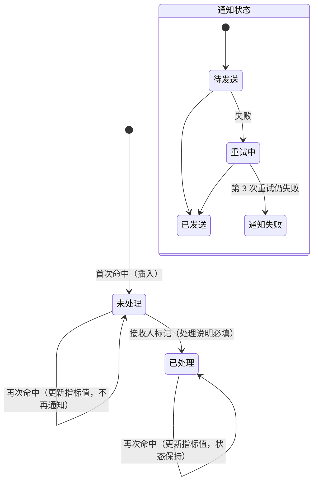

- 去重：唯一键（规则版本 ID, 对象类型, 对象 ID, 期间），用 `INSERT … ON CONFLICT DO UPDATE` 更新指标值；只有插入分支写入通知发件箱（AC-F11-02）。
- 「已处理后再次命中保持已处理」已按待确认处置定为默认：状态保持已处理，指标值更新并置 `updated_after_resolve = true`，列表显示「指标已更新」；不提供手动重发。品类类预警接收人为财务负责人与负责该渠道的运营。

#### 4.8.5 目标调整（DATA-F08-03、DATA-F03-02；AC-F08-01~04，DEC-022，SEQ-F08-01）

**DEC-022 单位两级逐个审 + CEO 整次终审**（对应 AC-F08-04，用户决定 4A）：调整本身（DATA-F08-03）与调整单位（DATA-F03-02，`adjustment_id` 非空）各有状态机。

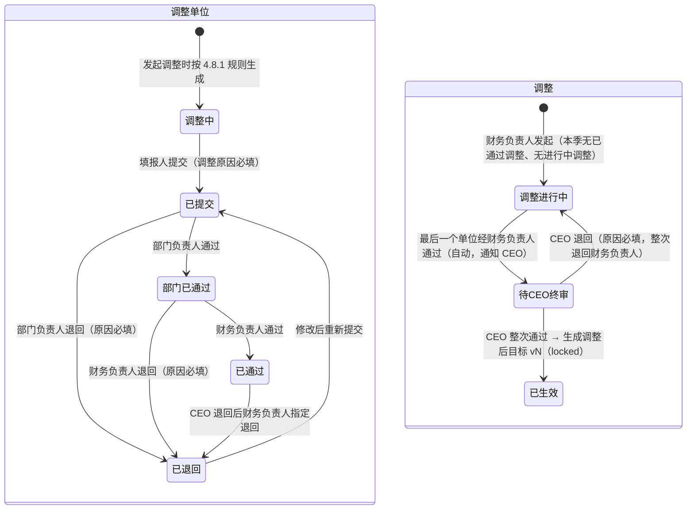

- 发起：同一年度只能有一个「调整进行中 / 待CEO终审」的调整（部分唯一索引），本季已有「已生效」调整时禁止（AC-F08-01）；发起时复制最新目标版本为调整稿（DEC-016）。
- 编辑：调整单位在各自填报表格以「调整模式」编辑，只允许尚未导入金蝶实际的月份（AC-F08-02）；其余月份单元格保存返回 422「该月已导入实际，不能调整」。
- 提交：单位调整原因为空返回 422「请填写调整原因」（AC-F08-03）。
- CEO 只审整次调整（API-F07-02 `type = adjustment`），不对单个单位操作；CEO 通过时同一事务内：调整稿 → 调整后目标 vN（版本号递增、`locked = true`），记录版本号、CEO 审批人、时间、各单位调整原因汇总；年初原始目标与此前版本不变（AC-F08-04）。
- 并发：所有迁移用 `UPDATE … WHERE status = 期望状态`；「最后一个单位通过 → 待CEO终审」在财务负责人通过的同一事务内以 `SELECT … FOR UPDATE` 锁住调整行后统计，防止两个并发通过都漏判或重复通知。
- 非法迁移示例：调整中 → 部门已通过；部门已通过 → 已通过（非财务负责人操作）；任一单位未「已通过」时 CEO 终审；已生效调整的任何迁移。

### 4.9 接口清单（API）

全部接口前缀 `/api`，JSON；金额与比率为字符串；除 API-F01-01/02/03 与健康检查外都需会话；每个接口的权限由 CMP-F01-03 强制。

| ID | 方法与路径 | 说明 | 来源 |
| :--- | :--- | :--- | :--- |
| API-F01-01 | GET /auth/config | 返回 CorpId、扫码授权地址参数、是否显示开发身份切换（生产恒为 false） | REQ-F01-01；DEC-002、DEC-013 |
| API-F01-02 | GET /auth/dingtalk/callback | 扫码回调：authCode → userid → 校验启用与角色 → 建会话 | AC-F01-01~03 |
| API-F01-03 | POST /auth/dingtalk/h5 | 工作台免登：授权码 → userid → 同上 | AC-F01-01~03 |
| API-F01-04 | POST /auth/logout | 注销会话 | REQ-F01-01 |
| API-F01-05 | GET /me | 当前用户姓名、角色、数据范围摘要、可见菜单 | AC-F01-01、AC-F01-04 |
| API-F01-06 | POST /dev/login-as | **仅开发配置注册**：以指定测试用户建会话 | DEC-002、DEC-013 |
| API-F01-07 | GET /admin/users；PUT /admin/users/{id}/roles | 员工列表（来自通讯录同步）；保存角色与范围（审计）；会使启用的财务负责人为 0 时返回 409 `last_finance_head` | AC-F01-04、AC-F01-05、NFR-004；DEC-019 |
| API-F00-01 | GET /workbench | 按角色的待办与关键数 | DEC-001；AC-F03-03、AC-F10-08、AC-F10-10、AC-F09-07 |
| API-F02-01 | GET/POST/PUT /master/channels、/master/stores | 渠道、店铺（站点、币种、启停、新渠道标记与起始月） | AC-F02-01、AC-F02-02、AC-F02-10、AC-F13-01 |
| API-F02-02 | POST /master/sku-mapping/upload；GET /master/sku-mapping?month= | SKU 对照表上传（走导入管线，整份校验，按 SKU 增改不删，SPU 上架日期取最早）；按月查看新老品判定 | AC-F02-03、AC-F02-04；DEC-021 |
| API-F02-03 | GET/POST/PUT /master/b-customers、/master/departments | B 端客户与部门 | AC-F02-09 |
| API-F02-04 | GET/PUT /master/account-mapping | 金蝶科目 → 预算科目（选项只含启用预算科目，已映射到停用科目的旧映射照常归集）；含导入出现的未映射科目；映射只改不删，修改只影响之后的导入 | AC-F02-05、AC-F02-12 |
| API-F02-05 | GET/PUT /master/fx/budget、/master/fx/actual | 年度预算汇率（返回年度 `locked`；已锁定年度修改已有币种返回 409 `fx_locked`「已随年初原始目标锁定」，新增尚无汇率的币种允许；锁定前修改触发重算）；月度实际汇率 = 当月平均汇率（> 0，最多 4 位小数；保存后重算该月核对与汇率差） | AC-F02-06、AC-F02-08、AC-F02-11；DEC-020 |
| API-F02-06 | GET/POST/PUT /master/budget-accounts（PUT 含 `status = 启用/停用`；无 DELETE） | 预算科目清单：新增、改名、停用；名称唯一，重名返回 422「预算科目名称已存在」；停用科目不进入之后生成的部门费用填报行与映射选项，已有预算与实际数据保留 | AC-F02-12、AC-F05-01 |
| API-F03-01 | GET/POST /tasks | 编制任务列表；发布（同年度唯一；按 AC-F03-05 生成填报单位，缺填报人或审核人返回 422 并列出单位；发通知） | AC-F03-01、AC-F03-02、AC-F03-05 |
| API-F03-02 | GET /tasks/{id}/progress | 各单位状态、提交率（（已提交 + 已通过）÷ 全部）、逾期标记 | AC-F03-03、AC-F03-04；DEC-026 |
| API-F03-03 | POST /tasks/{id}/submit-to-ceo | 提交 CEO（未全部通过时返回未通过单位名单） | AC-F07-04 |
| API-F04-01 | GET /filling-units?mine=1 | 我的填报单位、状态、退回原因 | AC-F04-09、AC-F07-03 |
| API-F04-02 | GET /filling-units/{id}/grid | 表格列定义（按角色裁剪）+ 行数据 + 合计 + 新渠道标注 | AC-F04-01、AC-F04-03~05、AC-F01-09、AC-F06-08、AC-F13-02 |
| API-F04-03 | PATCH /filling-units/{id}/cells | 批量保存单元格（每格带基准值）；返回重算后的行与受影响合计，或冲突/越界明细 | AC-F04-02、AC-F04-10、AC-F06-01~07、NFR-001 |
| API-F04-04 | POST /filling-units/{id}/fill-year | 对某维度组合把比率写入 12 个月中未提交月份 | AC-F04-06 |
| API-F04-05 | GET /filling-units/{id}/template | 下载 .xlsx 模板（范围内维度、本人输入项、预填已存值） | AC-F04-07 |
| API-F04-06 | POST /filling-units/{id}/template-upload | 上传模板（走导入管线，整份校验） | AC-F04-08 |
| API-F04-07 | POST /filling-units/{id}/submit | 提交（汇率、超放量理由校验）→ 锁定 → 通知部门负责人 | AC-F04-09、AC-F02-07、AC-F13-02、AC-F07-01 |
| API-F04-08 | PUT /filling-units/{id}/over-limit-reasons | 新渠道超放量理由 | AC-F13-02 |
| API-F05-01 | GET /dept-expense/{unitId}/grid（保存复用 API-F04-03） | 部门费用科目 × 月表格 + 历史参考 | AC-F05-01、AC-F05-02 |
| API-F05-02 | GET/POST /reserves；POST /reserves/{id}/usages | 专项预留额度；财务BP 登记使用 | AC-F05-03~05 |
| API-F06-01 | GET /versions/{id}/pl?dims=… | 按维度汇总的收入→毛利→净利润（双币），供报表与审批详情 | AC-F06-04~09 |
| API-F06-02 | GET/PUT /company-other-pl | 公司层其他损益（月） | AC-F06-06 |
| API-F07-01 | GET /approvals | 待我审批（编制单位、编制任务、目标调整单位〔部门负责人 / 财务负责人级〕、目标调整整次〔CEO〕、规则版本） | AC-F07-01、AC-F08-04 |
| API-F07-02 | POST /approvals/{type}/{id}/approve；/reject（type = unit / task / adjustment-unit / adjustment / rule-version） | 通过；退回（原因必填，空则 422「请填写退回原因」）；CEO 通过任务时锁定原始目标并冻结预算汇率；CEO 整次通过调整时生成调整后目标 vN；规则版本退回后不生效 | AC-F07-02~06、AC-F08-04、AC-F12-04、AC-F12-07、AC-F02-11 |
| API-F08-01 | GET /versions | 版本列表 | REQ-F08-01~03 |
| API-F08-02 | POST /versions/adjustments | 发起季度目标调整（本季已有已生效调整或存在进行中调整时 409 并返回原因；生成调整稿与调整单位、通知填报人） | AC-F08-01~03；DEC-022 |
| API-F08-06 | GET /versions/adjustments/{id} | 调整进度：各调整单位状态、调整原因、退回原因、CEO 终审状态 | AC-F08-03、AC-F08-04；DEC-022 |
| API-F08-03 | POST /versions/rolling | 发起滚动预测更新（通知相关角色） | AC-F08-05 |
| API-F08-04 | POST /versions/rolling/{id}/publish；POST /versions/rolling/publish-original | 发布快照；Q1 以原始目标发布 | AC-F08-06、AC-F08-07、AC-F08-09 |
| API-F08-05 | GET /versions/compare?a=&b=&dims= | 两版本对比（按范围）：维度行只含收入、毛利及差额；净利润及差额只在公司合计行 | AC-F08-08 |
| API-F09-01 | POST /imports（multipart，source = kingdee / bi / kingdee-history） | 上传并启动校验，返回批次 ID | AC-F09-01、AC-F09-04、AC-F09-08、NFR-002 |
| API-F09-02 | GET /imports/{id} | 批次状态、错误清单（行号、问题类型、名称）、是否需覆盖确认及被覆盖月份/旧批次 | AC-F09-01、AC-F09-05、AC-F09-08、AC-F09-09 |
| API-F09-03 | POST /imports/{id}/confirm（overwrite = true/false） | 确认入库 → 归集 → 核对 → 预警评估；需覆盖而 overwrite ≠ true 时 409 且不写入 | AC-F09-02、AC-F09-03、AC-F09-06、AC-F09-09、AC-F11-01 |
| API-F09-04 | GET /imports | 导入记录（含被替换文件名、导入人、时间） | AC-F09-03、NFR-004 |
| API-F09-05 | GET /reconciliation?month= | BI 与金蝶差异率（BI 本币 × 当月平均汇率），\|差异率\| > 3% 标记；缺汇率返回「缺少 YYYY-MM 汇率」 | AC-F09-07、AC-F02-08 |
| API-F10-01 | GET /reports/company?year= | 净利润达成率双口径（年初至最近导入月累计 ÷ 同期目标累计，分母 ≤ 0 返回空值）、增速对比、季度预测准确度 | AC-F10-08~10 |
| API-F10-02 | GET /reports/channel-site?month=&baseline= | 渠道×站点偏差、量价汇率与费率拆分、「口径差」行、未归属渠道；范围内有 B 端客户时增加「B 端」分组按客户逐行（收入、退款、各项费用、毛利、毛利率的预算/实际/差额/达成率；B 端无量价拆分） | AC-F10-01~05、AC-F10-12；DEC-024 |
| API-F10-03 | GET /reports/category?month= | 品类×新老品偏差（SPU 数、销量、折后品效、收入）、BI 截至月份 | AC-F10-06；DEC-025 |
| API-F10-04 | GET /reports/dept-expense?year= | 部门费用使用率与时间进度 | AC-F10-07 |
| API-F10-05 | PUT /variance-notes | 偏差说明（填写人、时间） | AC-F10-11 |
| API-F11-01 | GET /alerts | 预警列表（规则与版本、对象、期间、指标值、阈值、状态、通知状态） | AC-F11-01、AC-F11-05 |
| API-F11-02 | POST /alerts/{id}/resolve | 标记已处理（说明必填） | AC-F11-03 |
| API-F12-01 | GET/POST /rules | 规则列表；新建（待审批、可信度必选） | AC-F12-01~03 |
| API-F12-02 | GET /rules/{id}；POST /rules/{id}/versions | 规则详情与版本历史（含已退回版本及退回原因）；提交新版本（已有待审批版本时 409） | AC-F12-02、AC-F12-04、AC-F12-06、AC-F12-07、AC-F13-02；DEC-023 |
| API-F14-01 | GET /export?view=…&filters=… | 按页面视图与筛选导出 .xlsx（范围过滤） | AC-F14-01、NFR-003 |
| API-F00-02 | GET /health | 数据库连通、调度器心跳、磁盘剩余；不需会话、不含业务数据 | design-derived（运维探活，§7.3） |

单元格保存的并发规则 **DEC-007 单元格级乐观锁**（对应 AC-F04-10）：API-F04-03 的每个单元格携带「打开页面时的值（基准值）」。服务端在行锁内比较该字段当前值与基准值：相同则写入；不同则拒绝该格，返回最后修改人姓名与时间（取自行的 `updated_by`、`updated_at`），前端提示「该数据已被 {姓名} 于 {时间} 修改，请刷新后再改」。理由：同一预算单元的不同字段可能由不同角色维护（驱动与比率分表存放已大幅减少交叉），按字段比对比按整行版本号更贴合「同一单元格」的验收口径，且不产生误报。

### 4.10 关键业务流时序（SEQ）

#### SEQ-F07-01 编制：提交 → 部门审核 → 财务负责人提交 → CEO 审批锁定
对应 REQ-F04-05、REQ-F07-01、REQ-F07-02、AC-F04-09、AC-F07-01~06、AC-F02-07、AC-F13-02、NFR-004

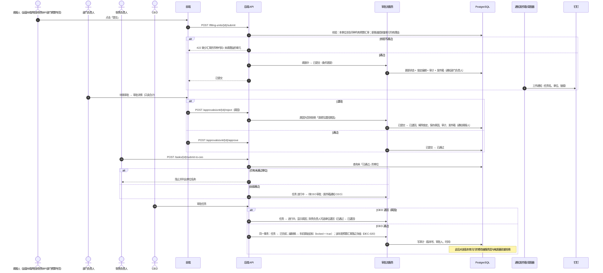

#### SEQ-F09-01 导入 → 计算 → 预警 → 钉钉通知（含失败重试）
对应 REQ-F09-01/02、REQ-F11-01/02、AC-F09-01~07、AC-F11-01/02/04/05、AC-F12-05、NFR-002、NFR-004、NFR-005

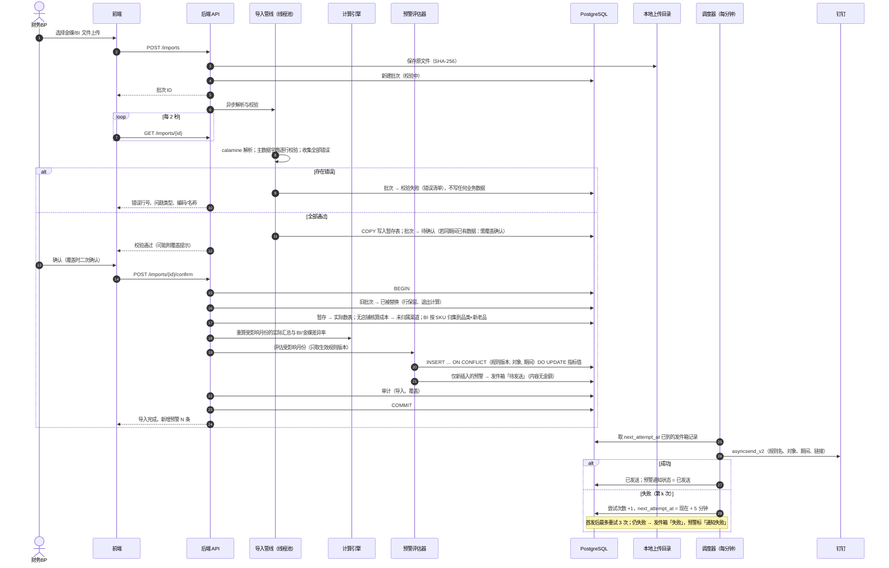

#### SEQ-F01-01 钉钉登录（扫码 / 免登 / 开发身份模拟）
对应 REQ-F01-01、AC-F01-01~03、DEC-002、DEC-013

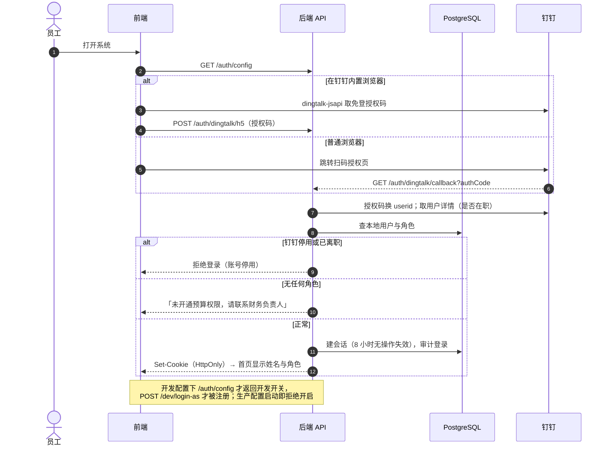

#### SEQ-F04-01 单元格保存 → 冲突检测 → 增量重算 → 合计刷新
对应 AC-F04-02、AC-F04-10、AC-F06-01~07、NFR-001

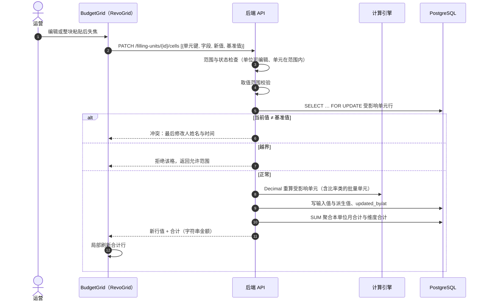

#### SEQ-F03-01 发布编制任务 → 生成填报单位 → 通知填报人
对应 REQ-F03-01、AC-F03-01、AC-F03-02、AC-F03-05、NFR-005；DEC-026

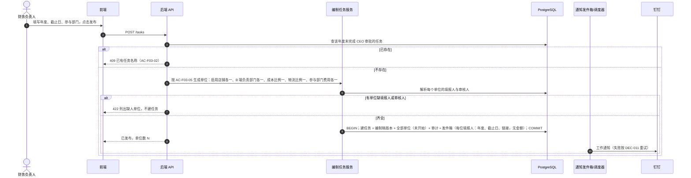

#### SEQ-F08-01 季度目标调整：单位两级审核 → CEO 整次终审 → 生成调整后目标
对应 REQ-F08-01、AC-F08-01~04、NFR-004；DEC-016、DEC-022

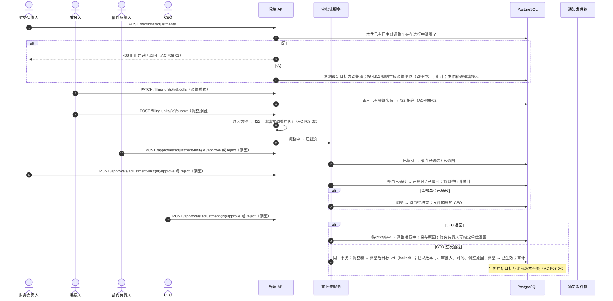

---

### 4.11 经营历史表导入、上年参考与同比（v1.2，requirements revision 5）

来源：用户 2026-10-28 上传财务部 2026 年经营分析表，要求作为各渠道站点实际数、编制 2027 年预算的参考，并在 2027 年偏差报告中加同比。

| ID | 内容 | 来源 |
| :--- | :--- | :--- |
| CMP-F09-03 | 后端经营历史表解析（services/ops_history.py）：读取全部「<渠道>-RMB」工作表的店铺分块（A 列分块名、B 列项目、表头「1月…12月」）与「管理费用RMB」的「N月实际」列；跳过汇总 / 验证分块和全部为 0 的月份；项目按别名映射到毛利口径（如「其他运营费用（软件费用等）」= 其他运营费用）；Excel 数值经导入服务同一读取边界转 Decimal（RULE-01） | AC-F09-10、AC-F09-12 |
| API-F09-01（扩展） | POST /imports 增加表单字段 `year`；`source=ops-history` 时必填（2000–2100），否则 422「请选择表格所属年度」 | AC-F09-10 |
| API-F09-06 | POST /imports/{id}/create-missing：批次校验失败且阻断问题全是缺主数据（店铺 / B 端客户 / 管理费用科目）时，按推断补建并同步重新校验，返回批次视图与新建数量；仅财务BP；写审计 `import_master_created` | AC-F09-11 |
| DATA-F09-05 | import_batch.source 允许 `ops-history`；新增 `data_year`（经营历史表所属年度）。迁移 0003 | AC-F09-10 |
| CMP-F10-02 | 后端上年实际（services/prior_actuals.py）：按店铺 / B 端客户读取某年各月毛利口径实际；生成填报表格参考行与 KPI；同比 =（本期 − 上年）÷ 上年绝对值，上年为 0 或缺失为空 | AC-F04-12、AC-F04-13、AC-F10-13 |
| DEC-027 | 经营历史表写入 kingdee_actual（kingdee_code = `ops-history`，summary 记「工作表 · 店铺 · 项目」），与金蝶月度、历史金蝶同一覆盖族：同期间互相覆盖，报表、部门费用历史参考、公司汇总同比无需改读路径。理由：一张实际表避免同期重复计入；后续月度金蝶导入自然替换同期经营表数据 | AC-F09-13 |
| DEC-028 | 校验问题分「阻断」与「提示」（errors 项 `warning=true`）：公式错误单元格、表内毛利额与重算差 > 1 元、负责部门不在主数据只提示；负责部门不在主数据的管理费用记 department_id 为空，部门费用报告全公司视角单列「公司公共（未分部门）」 | AC-F09-12、AC-F10-14 |

页面变化：PAGE-F09-01 增「经营历史表」页签（年度选择、补建计划、提示表、各渠道汇总）；PAGE-F04-02 / PAGE-F04-03 表格最上方灰底只读参考行（RevoGrid 行类型 `ref`）与 KPI 下方上年参考说明；PAGE-F10-02 增「同比」四列（导出同步）；PAGE-F10-04 增「上年同期实际」「同比」两列与同比 KPI（导出同步）。

### 4.12 业财分析（v1.3，requirements revision 6）

来源：用户 2026-10-28 上传「业财一体化工作台」（单文件 HTML，数据存浏览器 localStorage、自带登录），要求全部模块并入预算平台、按平台重写；缺数据源的指标保留模拟数据当演示。

| ID | 内容 | 来源 |
| :--- | :--- | :--- |
| DATA-F15-01 | bizfin_section：主键 key ∈ indicators / biz_dim / policy / keywork（revision 7 去掉 advice，迁移 0005）；data JSONB（该部分完整文档）、is_demo、revision、updated_by、updated_at。迁移 0004 | AC-F15-02、AC-F15-03 |
| API-F15-01 | GET /bizfin/sections：返回已保存的部分（未保存的不返回，前端用示例数据）及 can_edit / can_reset；CEO、财务负责人、财务BP | AC-F15-01 |
| API-F15-02 | PUT /bizfin/sections/{key}：body {data, revision, is_demo}；revision 与库中不一致返回 409「已被某某更新，请刷新后再改」（details.revision 为当前值）；成功 revision+1、写审计 `bizfin.save`（记部分、版本、示例标记）；财务负责人、财务BP | AC-F15-02 |
| API-F15-03 | POST /bizfin/reset：删除全部已保存部分（回到示例数据），写审计 `bizfin.reset`；仅财务负责人，页面二次确认 | AC-F15-03 |
| CMP-F15-01 | 后端存取服务 services/bizfin.py（行锁 + 版本校验 + 审计） | AC-F15-02 |
| CMP-F15-02 | 前端引擎 src/bizfin/engine.ts（原工作台全部非 DOM 计算逐行移植：指标体系、recompute 派生、validations 勾稽、健康度、九个分析模型、CSV 解析导出，保持原标识符）+ charts.ts（SVG 图表）+ persist.ts（读取装载、500ms 合并保存、冲突提示） | AC-F15-04、AC-F15-06 |
| CMP-F15-03 | 前端页面外壳 BizfinPage（页头、示例数据标记、年度 / 月度维度切换、保存状态、加载与错误态） | AC-F15-03、AC-F15-04 |
| DEC-029 | 业财数据按「部分」存 JSON 文档、计算全部在前端引擎：原工作台口径集中在约 2000 行相互依赖的 JS 中，逐行移植到 TS 可保证与原工具数值一致；服务端只负责权限、并发与审计。数据量小（单部分 < 1 MB），无需拆表。代价：服务端不能按指标查询，后续若要与预算版本 / 金蝶实际打通再拆结构化表 | AC-F15-02、AC-F15-04 |
| DEC-030 | 原工作台的登录、用户与权限面板不移植，改用平台角色（查看：CEO、财务负责人、财务BP；编辑：财务负责人、财务BP；恢复示例：财务负责人）；原样保留原期间口径（2026 年 1–9 月），不与平台预算年度联动 | AC-F15-01、RA-033 |

页面：PAGE-F15-02 财务指标、PAGE-F15-03 业务指标、PAGE-F15-05 数据分析（九个子模块页签）、PAGE-F15-06 政策环境、PAGE-F15-08 重点工作进度、PAGE-F15-09 业财数据管理；revision 7 删除 PAGE-F15-01 经营总览驾驶舱、PAGE-F15-04 业财联动关系、PAGE-F15-07 经营建议（迁移 0005：bizfin_section 不再接受 advice，已存经营建议随模块删除；引擎去掉仅供三页使用的 ADVICE_*、deptScores、buildReverse、bizState）；侧栏新增「业财分析」分组（位于「报表」之后）。

### 4.13 模块精简与侧栏调整（v1.4，requirements revision 7～8）

来源：用户 2026-10-28～29 要求删除业财分析的经营总览驾驶舱、业财联动关系、经营建议、重点工作进度、业财数据管理，删除部门费用报告，并调整侧栏分组。

| 变更 | 内容 | 来源 |
| :--- | :--- | :--- |
| 侧栏分组 | 预算编制（编制任务、我的填报、部门费用、待我审批、预算版本）· 实际数 · 预算执行（公司汇总、渠道×站点偏差、品类×新老品偏差、预算预警）· 业财分析（财务指标、业务指标、数据分析、政策环境）· 基础数据 · 系统设置。原「预算版本」组的「版本管理」改名「预算版本」并入预算编制；原「报表」组改名「预算执行」；原「预警与规则」组撤销 | 用户 2026-10-29 |
| 预算预警 | 预警中心（PAGE-F11-01）与规则库（PAGE-F12-01）合并为一个模块：侧栏只保留「预算预警」（菜单键 alerts），两页页头统一为「预算预警」并显示页签「预警记录 / 规则库」（组件 AlertTabs）；规则库页签按原 rules 菜单权限显示（CEO、财务负责人、财务BP）；路由与接口不变，规则库、规则详情为预算预警的子页，侧栏高亮按父链取最上级（navKeyFor）；钉钉通知链接文案改为「预算管理平台 › 预算预警」 | 用户 2026-10-29 |
| 删除部门费用报告 | 删除 PAGE-F10-04、API-F10-04（GET /reports/dept-expense，现 404）、导出视图 report-dept（现 422）、偏差说明类型 dept-expense（新提交 422；库内已有记录保留，无读取入口）；公司汇总「部门费用合计」行不再链接；部门对象预警不再给「查看相关报表」链接（接收人部门负责人 / 财务负责人 / CEO 没有可访问的部门明细页） | REQ-F10-04 退役、RA-036 |
| 删除业财数据管理、重点工作 | 删除 PAGE-F15-08、PAGE-F15-09 与 API-F15-03（恢复示例数据）；迁移 0006：bizfin_section 不再接受 keywork 并删除已存重点工作；引擎去掉 CSV 导入导出、重点工作相关代码；示例数据标记改为「该部分在页面上修改保存后即为正式数据」 | REQ-F15-05 退役、RA-035 |
| 删除驾驶舱、业财联动、经营建议 | 见 §4.12 页面说明（迁移 0005） | revision 7 |

## 5. 数据层选型

### 5.1 主数据库

已确认（蓝图 §8）：**PostgreSQL 18.6**，单实例。
- 决策证据：`NUMERIC` 精确十进制满足 AC-F06-09；事务 + 行锁支撑提交锁定与乐观锁；`INSERT … ON CONFLICT` 支撑预警去重；部分唯一索引支撑「每条规则一个生效版本」；触发器支撑审计与锁定版本不可改；`COPY` 支撑 5 万行导入。18 为 current 主版本、EOL 2030-11-14，覆盖试运行与后续阶段。
- 当前代价：单实例无高可用，依赖每日备份。
- 升级触发条件：信息数字化部提出明确的 RPO < 24 小时或高可用要求时，增加 WAL 归档或流复制备库。

字符集 UTF-8，时区 `Asia/Shanghai`；应用使用独立数据库账号（非超级用户），审计表权限按 DEC-010 收紧。

**数据模型（DATA）**

预算单元键（平台渠道）：**版本 × 月 × 渠道 × 店铺 × 站点 × 品类 × 新老品**，唯一约束 `(version_id, month, channel_id, store_id, site_id, category_id, is_new)`；店铺必须属于该渠道、站点必须为该店铺站点（外键 + 检查）。B 端单元键：版本 × 月 × B 端客户。部门费用键：版本 × 月 × 部门 × 预算科目。

| ID | 实体（表） | 关键字段 | 来源 |
| :--- | :--- | :--- | :--- |
| DATA-F01-01 | 用户 user | 钉钉 userid（唯一）、unionId、姓名、所属钉钉部门、启用状态、最近同步时间 | REQ-F01-01、AC-F01-03 |
| DATA-F01-02 | 角色分配与数据范围 user_role / user_scope | 用户、角色（8 类）；范围类型（部门 / 渠道 / 店铺 / B 端客户）+ 对象 ID | REQ-F01-02、REQ-F01-03、AC-F01-04~11 |
| DATA-F01-03 | 会话 session | 令牌哈希、用户、认证来源（dingtalk / dev）、最近活动时间、过期时间 | REQ-F01-01、蓝图 §9、DEC-013 |
| DATA-F02-01 | 渠道 channel / 店铺 store / 站点 site | 渠道：名称、是否新渠道、新渠道起始月；店铺：名称（唯一）、所属渠道、站点、结算币种、启停 | REQ-F02-01、AC-F02-01/02/10、REQ-F13-01 |
| DATA-F02-02 | 部门 department / B 端客户 b_customer | 部门：名称、负责人；客户：名称、负责部门（美国业务部 / 外贸部）、结算币种 | REQ-F02-05、AC-F02-09 |
| DATA-F02-03 | 预算科目 budget_account / 金蝶科目映射 kingdee_account_map | 预算科目：名称（唯一）、是否部门费用科目、状态（启用/停用）、排序，只停用不删除，数据行以科目 ID 关联故改名不影响历史；金蝶科目编码 → 预算科目（只改不删） | REQ-F02-03、AC-F02-05、AC-F02-12、AC-F09-02 |
| DATA-F02-04 | 品类 category / SPU / SKU | SKU（编码唯一、上架日期）→ SPU（品类唯一）→ 品类；SPU 首次上架日期 = 其下 SKU 上架日期最小值（派生列，上传事务内重算）；SKU 只增改不删 | REQ-F02-02、AC-F02-03/04；DEC-021 |
| DATA-F02-05 | 汇率 fx_budget / fx_actual | 年度 × 币种预算汇率（年度存在年初原始目标即锁定，触发器禁止 UPDATE/DELETE，允许新增该年度尚无汇率的币种）；月 × 币种当月平均汇率（> 0，4 位小数） | REQ-F02-04、AC-F02-06~08、AC-F02-11；DEC-020 |
| DATA-F03-01 | 编制任务 budget_task | 年度、截止日、状态、CEO 退回原因；同年度未完成任务唯一 | REQ-F03-01/02、AC-F03-02、AC-F07-04~06 |
| DATA-F03-02 | 填报单位 filling_unit | 任务或目标调整（`task_id` / `adjustment_id` 二选一）、版本、类型（平台运营〔店铺〕、B 端〔负责部门〕、物流比例、成本比例、部门费用〔部门〕）、范围对象、填报人、审核人、状态（调整单位多一个「部门已通过」）、退回原因、调整原因 | AC-F03-03、AC-F03-05、AC-F04-09、REQ-F07-01、AC-F08-03/04 |
| DATA-F04-01 | 平台渠道预算单元 platform_unit | 预算单元键 + 七个驱动 + 派生（销量、本币收入、人民币收入、各项费用、毛利、毛利率）+ 超放量理由 + updated_by/at | REQ-F04-01、REQ-F06-01、AC-F13-02 |
| DATA-F04-02 | 渠道品类成本比例 channel_category_ratio | 版本 × 月 × 渠道 × 站点 × 品类：采购成本占比（财务BP）、头程/尾程/仓储/关税率（物流物控） | AC-F04-04、AC-F04-05 |
| DATA-F04-03 | 渠道站点比例 channel_site_ratio | 版本 × 月 × 渠道 × 站点：库存索赔率、其他运营费用率 | AC-F04-11 |
| DATA-F04-04 | B 端预算单元 b2b_unit | 版本 × 月 × 客户：销售额（本币）、六项比率（佣金、索赔默认 0）、采购成本占比、物流四项、派生值 | REQ-F04-02、AC-F04-03~05、AC-F06-05 |
| DATA-F05-01 | 部门费用预算 dept_expense | 版本 × 月 × 部门 × 预算科目：人民币金额 | REQ-F05-01 |
| DATA-F05-02 | 专项预留额度 reserve / 使用登记 reserve_usage | 名称、部门、科目、金额、计划月份；使用：金额、日期、金蝶凭证号 | REQ-F05-02、AC-F05-03~05 |
| DATA-F06-01 | 公司层其他损益 company_other_pl | 版本 × 月 × 项目（财务费用、汇兑损益、营业外收支、所得税） | AC-F06-06、AC-F06-07 |
| DATA-F07-01 | 审批记录 approval_record | 对象类型与 ID、级别、动作（通过/退回）、原因、审批人、时间 | REQ-F07-01/02、AC-F08-04、AC-F12-04 |
| DATA-F08-01 | 预算版本 budget_version | 年度、类型（编制稿/年初原始目标/调整稿/调整后目标/滚动预测稿/季度快照）、版本号、季度、调整原因、locked、发布日期、来源版本 | REQ-F08-01~03、AC-F07-05 |
| DATA-F08-03 | 目标调整 target_adjustment | 年度、季度、状态（调整进行中 / 待CEO终审 / 已生效）、调整稿版本、生成的调整后目标版本、发起人、CEO 退回原因、生效时间；部分唯一：同年度进行中至多一个、同年度季度已生效至多一个 | REQ-F08-01、AC-F08-01~04；DEC-022 |
| DATA-F08-02 | 快照月度汇总 snapshot_month | 快照版本 × 月：数据来源（实际/预测）、人民币收入、毛利、净利润（冻结） | AC-F08-06、AC-F08-07、AC-F10-10 |
| DATA-F09-01 | 导入批次 import_batch | 来源、期间、原文件路径/名/SHA-256、上传人、状态、错误清单（JSONB）、被替换批次、各阶段时间戳 | REQ-F09-01/02、AC-F09-03、NFR-002 |
| DATA-F09-02 | 导入暂存 import_staging | 批次、行号、解析后字段（确认后清理） | DEC-008 |
| DATA-F09-03 | 金蝶实际 kingdee_actual | 批次、期间、部门、店铺、站点、B 端客户（客户辅助核算匹配时）、预算科目、金额；未归属渠道标记 | AC-F09-01~04、AC-F10-12 |
| DATA-F09-04 | BI 实际 bi_actual_sku / bi_actual_agg | 明细：批次、月、店铺、站点、SKU、销量、本币销售额、币种、广告费、平台费；归集：月 × 店铺 × 站点 × 品类 × 新老品的 SPU 数、销量、本币/人民币收入 | AC-F09-05~07、AC-F10-03、AC-F10-06 |
| DATA-F10-01 | 偏差说明 variance_note | 报告类型、月、对象、说明、填写人、时间 | AC-F10-11 |
| DATA-F11-01 | 预警记录 alert | 规则版本、对象、期间、指标值、阈值、处理状态、处理人/时间/说明、通知状态、处理后指标已更新标记；唯一（规则版本, 对象, 期间） | REQ-F11-01、AC-F11-01~05 |
| DATA-F11-02 | 通知发件箱 notification_outbox | 业务类型与 ID、接收 userid 列表、模板参数（无金额）、状态、尝试次数、下次尝试时间、最后错误、钉钉 task_id | AC-F11-05、NFR-005、AC-F03-01/04、AC-F07-01/03、AC-F08-05 |
| DATA-F12-01 | 规则 rule | 名称、类型（驱动假设/预警规则/额度标准）、当前生效版本 | REQ-F12-01 |
| DATA-F12-02 | 规则版本 rule_version | 规则、版本号、内容（JSONB：指标、比较方式〔低于/高于/低于等于/高于等于〕、阈值、连续月数、适用对象、接收角色；或新渠道放量上限 `limits[1..12]`）、可信度、依据、状态（待审批/待CEO审批/生效/历史/已退回）、退回原因、提交人、审批人、生效时间 | AC-F12-01~07、AC-F13-02；DEC-023 |
| DATA-F00-01 | 审计日志 audit_log | 时间、操作人、操作类型、对象、前值、后值（JSONB）、请求 ID、IP、认证来源；只追加 | NFR-004 |

**核心关系**

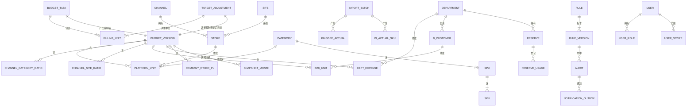

**DEC-016 版本只增不改**（对应 AC-F07-05、AC-F08-04、AC-F08-07、蓝图 §9）：所有预算数据表都以 `version_id` 为首列。发起调整或滚动预测时，复制来源版本的全部单元与比率行到新版本（单版本约 2 万单元，复制为秒级）；锁定版本由触发器禁止修改。季度快照额外写入 DATA-F08-02 的冻结月度汇总（已导入金蝶实际的月份取实际，AC-F08-06），供 AC-F10-10 直接读取。数据量估算：每年约 10 个版本 × 2 万单元 ≈ 20 万行，PostgreSQL 单表无压力。

**扩展说明**：后续现金流预算按蓝图 §4，在同一「月 × 渠道 × 店铺 × 站点」键上增加账期字段即可，本期不预留表或字段。

### 5.2 缓存层（未激活）
不引入。依据：150 人内部工具、单版本 ≤ 2 万单元，合计用 SQL 聚合即可满足 NFR-001。升级触发条件：在 §1.4 测量下 P95 超过 2 秒（留出余量）且慢点确认在聚合查询时，先加物化汇总表，仍不够再考虑缓存。

### 5.3 搜索引擎（未激活）
不引入。列表筛选（店铺、SKU、员工）用数据库 `ILIKE` 与索引即可，数据量为千到万级。

### 5.4 文件存储（条件维度激活：导入原文件与导出）

决策门禁核实：单实例部署；服务器本地磁盘持久（Linux 下为 Docker 命名卷或宿主目录挂载，Windows 下为本地目录）；文件规模每月约金蝶 1 份 + BI 0.5 份 + 若干模板上传，单份 ≤ 数十 MB，年增量预计 < 5 GB；无客户端直传、无 CDN、无跨实例共享；备份 RPO 24 小时。
- **推荐**：服务器本地持久目录 `data/uploads/`（原文件，按年月分目录，文件名为批次 ID，库中存元数据与 SHA-256）；`data/exports/` 存放导出临时文件，生成后流式下载，每日清理超过 1 天的文件。
- 当前代价：随服务器单点。
- 升级触发条件：多实例部署或磁盘容量不足时，再评估公司内部的文件服务器或国内对象存储。

### 5.5 备份

**DEC-015 每日备份、保留 30 天，由操作系统计划任务执行**（对应蓝图 §9、NFR-004）：
- 内容：`pg_dump` 自定义格式全库备份 + `data/uploads/` 目录归档（原文件用于追溯，属于审计证据链）。
- 时间：每日 01:30（避开通讯录全量同步 02:00 与逾期提醒 09:00）。
- 保留：备份脚本在成功生成当日文件后删除 30 天前的文件；失败时不删除旧文件，并写入错误日志。
- Linux：宿主机 cron（或 systemd timer）执行 `docker compose exec db pg_dump …`，输出到宿主目录 `backup/`。
- Windows：任务计划程序每日运行备份脚本，调用 PostgreSQL 安装目录下的 `pg_dump.exe`。
- 异地：建议信息数字化部把 `backup/` 同步到另一台机器或公司 NAS（不新增外部服务，由其现有设施完成，列为待确认）。
- 恢复演练：上线前在验收机上用最近一次备份执行一次 `pg_restore` 并核对数据条数，记录 RTO。
- 选择操作系统计划任务而非应用内调度：应用停机时备份仍会运行，且备份与应用进程解耦。

---

## 6. AI 能力选型

不适用：本期无 AI 能力。NFR-005 与 PRD §10.3（OQ-15）明确系统不调用外部大模型，偏差说明由财务BP 手写。

---

## 7. 基础设施选型

### 7.1 部署与托管

**DEC-004 单体服务**（对应蓝图 §8、NFR-006）：FastAPI 同进程提供 `/api` 与前端静态文件（SPA 路由回退到 `index.html`），Uvicorn 单进程；不引入 Nginx（内网 HTTP 直连即可；如需 HTTPS，Uvicorn 可直接加载证书）。

**DEC-014 两种部署路径**（对应蓝图 §8「服务器系统未知，给出两种方式」、NFR-006）：服务器系统未知，因此同一安装包支持两条路径，代码不依赖任何单一平台特性（路径用 `pathlib`，换行与编码统一 UTF-8，不使用 Linux 专属系统调用）。

| 维度 | 路径 A：Windows 原生（开发验收机；若服务器为 Windows 也用此路径） | 路径 B：Linux + Docker Compose（若服务器为 Linux） |
| :--- | :--- | :--- |
| 运行组件 | Python 3.14.10（python.org 安装器或 npmmirror 二进制镜像）；PostgreSQL 18.6（EDB Windows 安装器） | 两个容器：`app`（基于 python:3.14.10-slim-bookworm 构建）、`db`（postgres:18.6-bookworm）；命名卷存数据库，宿主目录挂载 `data/` 与 `backup/` |
| 安装包内容 | 后端源码、`wheels/win_amd64/` 离线 wheel、已构建前端、Alembic 迁移、启动/备份/审计导出脚本、`.env.example` | 同一份源码与前端产物 + `images/app.tar`、`images/postgres.tar`（`docker save` 离线镜像）+ `compose.yaml` + `.env.example` |
| 安装 | 安装 Python 与 PostgreSQL → 创建数据库与应用账号 → `pip install --no-index --find-links wheels` → 执行迁移 → 填 `.env` | `docker load` 两个镜像 → 填 `.env` → `docker compose up -d` → 容器启动时自动执行迁移 |
| 常驻与自启 | 任务计划程序「开机启动」运行启动脚本（系统自带，无第三方服务包装器） | Compose `restart: unless-stopped` |
| 备份 | 任务计划程序每日调用 `pg_dump.exe` 脚本 | 宿主 cron 调用 `docker compose exec db pg_dump` |
| 配置 | `.env`（`APP_ENV=prod`，钉钉凭据由信息数字化部填写） | 同左，通过 Compose `env_file` 注入 |
| 网络 | 监听内网端口（默认 8000）；出站放行 `*.dingtalk.com:443` | 同左；数据库端口不对宿主外暴露 |

Docker 镜像离线交付的原因：国内访问 Docker Hub 不稳定，蓝图要求不依赖境外服务；在可访问的构建机上 `docker build` + `docker save`，服务器只需 `docker load`。若信息数字化部有内网镜像仓库，可推送到其仓库代替 tar（不新增外部服务）。

**国内可达与依赖安装**（DEC-018，对应蓝图 §8）：

| 生态 | 推荐源 | 本次核实 | 安装方式 |
| :--- | :--- | :--- | :--- |
| PyPI | 阿里云镜像 `https://mirrors.aliyun.com/pypi/simple/`（备用：腾讯云 `https://mirrors.cloud.tencent.com/pypi/simple/`） | 两者返回 200，阿里云已含 fastapi-0.162.0 wheel；清华镜像在本核实环境连接失败，未作首选 | uv 设置默认索引为该镜像；打包时 `uv export` + `pip download --platform win_amd64/manylinux…` 生成离线 wheel 目录 |
| npm | npmmirror `https://registry.npmmirror.com` | 返回 200，已同步 RevoGrid 4.29.1、Vue 3.5.44 | 项目 `.npmrc` 指定 registry；`npm ci` 按锁文件安装 |
| Python / Node 安装器 | npmmirror 二进制镜像 `https://registry.npmmirror.com/-/binary/python/`、`/-/binary/node/` | 已列出 Python 3.14.10、Node v24.22.1 目录 | 开发机安装；服务器只需 Python（路径 A）或 Docker（路径 B） |
| 前端运行时依赖 | 无 CDN | — | 全部由 Vite 打包进 `static/`，含 Element Plus 中文语言包、图标、RevoGrid、dingtalk-jsapi；不引用外部字体 |

### 7.2 认证与授权

已确认（蓝图 §3、§9）：钉钉身份，无账号密码；会话 8 小时无操作失效。
- **推荐**：钉钉企业内部应用（扫码 OAuth2 + H5 免登）+ 服务端有状态会话（DATA-F01-03）。
- 会话实现：登录成功生成 256 位随机令牌，库中只存哈希；Cookie `HttpOnly`、`SameSite=Lax`（HTTPS 时加 `Secure`）；每次请求刷新最近活动时间，超过 8 小时无操作即失效；每次请求校验用户启用状态与至少一个角色（AC-F01-02/03）。
- 写操作防跨站：校验 `Origin` 与本站一致。
- 授权：DEC-009（§4.5）。
- 当前代价：钉钉不可用时所有人无法登录（PRD §5.3，用户已接受）。
- 升级触发条件：无（用户已明确不提供备用登录）。

**DEC-013 开发身份模拟（DEC-002）如何确保生产关闭**（对应 DEC-002、REQ-F01-01、NFR-003）：
1. **配置双开关**：只有 `APP_ENV=dev` 且 `DEV_IDENTITY_SWITCH=true` 时，`/dev/login-as` 路由才被注册；否则该路径不存在（404）。
2. **生产启动自检**：`APP_ENV=prod` 时若 `DEV_IDENTITY_SWITCH` 为真、或钉钉四项凭据任一缺失，进程拒绝启动并输出明确错误——不可能「带着开关上线」。
3. **前端构建剔除**：生产构建模式下身份切换组件被编译期常量整段移除；即使后端误报开关，生产包里也没有该入口。API-F01-01 在生产恒返回 false。
4. **会话来源隔离**：开发登录产生的会话标记 `auth_source=dev`；生产模式下认证中间件拒绝任何 `auth_source=dev` 的会话，且启动时清除此类会话（防止把开发数据库直接带到生产）。
5. **审计可见**：每次开发登录写审计，便于验收阶段追溯。
6. **验证**：自动化测试以生产配置启动应用，断言 `/api/dev/login-as` 返回 404、`/api/auth/config` 的开关为 false、生产配置 + 开关为真时启动失败；部署手册的上线检查单包含「登录页无身份切换入口」。

开发数据：开发配置提供种子脚本，生成使用真实中文姓名、部门与渠道的测试用户（如「运营部 · 王海涛 · Amazon 美国站」），覆盖 8 类角色。

### 7.3 可观测性

- **推荐**：Python 标准库 `logging` 输出单行 JSON 到 `data/logs/`，按天滚动、保留 90 天；每个请求带请求 ID，记录路径、用户 ID、状态码、耗时 `duration_ms`；导入批次记录各阶段耗时；钉钉调用记录 errcode（不记录消息正文与凭据）。`/api/health` 返回数据库连通、调度器最近心跳、磁盘剩余空间，供信息数字化部现有监控探活。
- 决策证据：单机内部系统；NFR-001/002 的测量需要耗时日志；禁止使用境外 SaaS 监控（铁律 7）。
- 当前代价：没有集中式告警与错误聚合，需人工查看日志。
- 升级触发条件：信息数字化部已有自建日志平台（如 ELK、Loki）时，直接接入其采集；或线上错误需要主动告警时，再评估自建 Sentry。
- 日志不得包含金额明细与钉钉凭据（NFR-005），在日志格式化器中统一过滤。

### 7.4 CI/CD

- **推荐**：本期不引入 CI 平台。仓库提供一个检查脚本（Windows 与 Linux 各一份），依次执行：后端 pytest、前端类型检查（vue-tsc）与 Vitest、前端生产构建、生产配置启动自检（DEC-013 测试）、打包（离线 wheel、前端产物、Docker 镜像 tar）。每次发版前在开发机跑通后生成安装包交给信息数字化部。
- 决策证据：1–3 人团队、单服务、发版频率低；Git 托管平台未在蓝图确认，不新增依赖。
- 升级触发条件：团队超过 3 人或每周多次发版时，在公司已有的代码托管平台上配置流水线（如公司已用 Gitee 或自建 GitLab）。

### 7.5 条件能力（按需激活）
- 实时通信：未激活。通知全部走钉钉工作通知（蓝图 §5），页面数据在打开或保存时刷新，导入状态用 2 秒轮询。
- 文件 / 富媒体：已激活，见 §5.4（本地持久目录）。
- 支付 / 计费：未激活。
- 多端 / 跨平台：未激活。钉钉内置浏览器加载的是同一网页，不另做端。

---

## 8. 实施建议与风险全景

### 8.1 推荐技术栈一览（最终决断）

| 层级 | 推荐技术 | 版本 / 备注 |
| :--- | :--- | :--- |
| 前端框架 | Vue + TypeScript + Vite | 3.5.44 / 6.0.3 / 8.3.5；Node 24.22.1 LTS 仅用于构建 |
| 前端路由与状态 | Vue Router + Pinia | 5.4.0 / 4.1.0 |
| 中文组件库 | Element Plus | 2.14.7（MIT） |
| 类 Excel 表格 | RevoGrid + Vue 3 封装 | 4.29.1（MIT，不用 Pro 功能） |
| 钉钉前端 SDK | dingtalk-jsapi | 3.2.9（MIT，随包打包） |
| 后端框架 | Python + FastAPI + Uvicorn | 3.14.10 / 0.162.0 / 0.54.0（单进程） |
| 数据访问与迁移 | SQLAlchemy + psycopg + Alembic | 2.1.6 / 3.3.6 / 1.20.1 |
| 校验与配置 | Pydantic + pydantic-settings | 2.14.1 / 2.16.1 |
| Excel | python-calamine（读）+ openpyxl（写） | 0.9.0 / 3.1.5 |
| 定时与重试 | APScheduler（进程内） | 3.11.3 |
| 出站 HTTP | httpx（仅钉钉域名） | 0.28.1 |
| 主数据库 | PostgreSQL 单实例 | 18.6 |
| 缓存 / 搜索 / 队列 | 不引入 | — |
| 文件存储 | 服务器本地持久目录 | `data/uploads`、`data/exports` |
| 认证 | 钉钉企业内部应用 + 服务端会话 | 8 小时无操作失效；开发身份模拟仅开发配置 |
| 部署 | Windows 原生 / Linux Docker Compose | 离线 wheel 与离线镜像 tar 交付 |
| 备份 | pg_dump + 上传目录归档，操作系统计划任务 | 每日 01:30，保留 30 天 |
| 可观测 | JSON 文件日志 + /api/health | 日志保留 90 天 |
| 测试 | pytest / Vitest | 9.1.1 / 5.0.5 |
| 依赖锁定与源 | uv + npm；阿里云 PyPI 镜像、npmmirror | uv 0.13.x |

### 8.2 本期实施起步建议

1. **脚手架（第 1–2 天）**：建立 `backend/`（FastAPI 应用、配置、Alembic）与 `frontend/`（Vite + Vue + Element Plus）；配置国内镜像与锁文件；FastAPI 托管前端构建产物；落实 DEC-013 的配置双开关与生产启动自检及其测试。
2. **高风险最小样例（第 1–3 天并行）**：RevoGrid 在 Chrome、Edge、钉钉内置浏览器中验证四项——从 Excel 粘贴 12 列 × 50 行、维度列冻结、中文输入法编辑、2 万行滚动；不通过即切换 AG Grid Community 方案（§3.2 次选）。
3. **数据模型与计算引擎（第 1 周）**：建全部 DATA 表与约束、触发器（锁定版本、审计只追加）；计算引擎纯函数及逐条 AC 单元测试；预置三条规则（AC-F12-03）。
4. **权限与开发身份（第 1 周）**：角色、范围、ScopeContext、路由全覆盖测试；开发身份切换与中文种子数据，使本机可按 8 类角色验收。
5. **填报闭环（第 2 周）**：主数据维护 → 编制任务 → 五类填报表格（含模板上传下载）→ 提交锁定 → 三级审批 → CEO 锁定（SEQ-F07-01）；NFR-001 性能测量。
6. **实际数与报表（第 3 周）**：导入管线（SEQ-F09-01）与 NFR-002 测量；核对、偏差报告、公司汇总、导出。
7. **版本与规则、预警（第 4 周）**：季度调整、滚动预测与快照、版本对比；规则库审批与版本；预警评估、发件箱与重试。
8. **钉钉联调与部署（11-30 前后）**：钉钉凭据到位后联调扫码、免登、通讯录同步、工作通知；按服务器系统选择路径 A 或 B 在内部服务器演练安装、备份与恢复；关闭开发开关，执行上线检查单，12-01 发布编制任务。

> 以上步骤仅覆盖本期 scope。现金流预算与金蝶 WebAPI 在对应阶段启动时再补充。

### 8.3 后续阶段扩展预留

| 扩展点 | 为哪个阶段/能力预留 | 预留方式 |
| :--- | :--- | :--- |
| 现金流预算 | 后续阶段 | 无需本期预留：蓝图 §4 已确认在「月 × 渠道 × 店铺 × 站点」键上增加账期字段即可，本期不建表、不加字段 |
| 金蝶星空 WebAPI 自动取数 | 后续阶段 | 无需本期预留：只替换导入来源。导入管线的「解析」步骤是唯一接入点，WebAPI 拉取的数据进入同一「校验 → 暂存 → 确认」流程（DEC-008）；本期不写适配代码 |

### 8.4 全局风险与缓解

| 风险 | 影响 | 缓解措施 |
| :--- | :--- | :--- |
| 钉钉企业内部应用 11-30 才就绪，晚于开发窗口；无备用登录 | 高：延期则 12-01 无法发布编制任务 | DEC-002/DEC-013 开发身份模拟保证本机全量验收不等钉钉；钉钉相关代码集中在 CMP-F11-02/CMP-F01-02，凭据到位当天即可联调；建议信息数字化部提前给出测试用的 AppKey |
| 内部服务器无法出站访问 `*.dingtalk.com` 或浏览器无法打开扫码页 | 高：无法登录与通知 | 部署前由信息数字化部确认放行；`/api/health` 增加钉钉 token 获取检查，安装当天即可发现 |
| 服务器操作系统未知 | 中：部署路径与操作手册不同 | DEC-014 两条路径同时准备，代码不依赖平台特性；开发期在 Windows 本机跑路径 A，用一台 Linux 虚拟机演练路径 B |
| RevoGrid 在钉钉内置浏览器或中文输入法下有缺陷 | 中：填报体验不达蓝图 | §8.2 第 2 步首周最小样例；次选 AG Grid Community + 自研粘贴 |
| 停用账号识别延迟（≤ 10 分钟）与 AC-F01-03「下一次请求失效」的口径差异 | 中：验收可能判不通过 | 待确认：如需零延迟，信息数字化部为应用开通通讯录事件订阅；否则在 TDD 中把「系统得知停用后的下一次请求」作为验收口径 |
| 金蝶/BI 导出格式与模板不一致 | 中：导入大量报错 | 首周向财务BP 要真实导出样例文件（脱敏）定义模板；表头校验给出清晰提示 |
| 单机单库无高可用 | 中：硬件故障需从备份恢复，最多丢 24 小时数据 | 每日备份 + 建议异地复制 + 上线前恢复演练；内部工具可接受 |
| 进程内调度器在进程停机时不执行 | 低：通知或逾期提醒延后 | 发件箱持久化，重启后继续；逾期检查在启动时补跑当日未执行的任务 |
| 已处理预警再次命中时是否重新打开未在需求中定义 | 低 | 已按 2026-10-27 待确认处置定为保持「已处理」、更新指标值并显示「指标已更新」（§4.8.4） |
| 通讯录同步停用了最后一名财务负责人 | 中：无人能分配角色 | DEC-019：`/api/health` 告警，信息数字化部改 `BOOTSTRAP_FINANCE_HEAD_USERID` 后重启恢复 |
| 新渠道放量上限数值由财务负责人填写且须经 CEO 审批，上线时可能尚无生效版本 | 低：AC-F13-02 暂不触发标注 | DEC-023：无生效版本时不标注；编制任务发布前提醒财务负责人完成该规则审批 |
| 是否启用 HTTPS 取决于信息数字化部是否提供证书 | 低：内网 HTTP 下 Cookie 不能加 Secure | 有证书则 Uvicorn 直接加载；无证书按内网 HTTP 运行，列为待确认 |

### 8.5 技术负责人的最终结论

#### 是否可以立即开工
- 明确选择：**可以开工**。全部选型已在蓝图确认范围内，版本已核实；钉钉依赖通过开发身份模拟解耦，不阻塞开发与本机验收。上线（而非开工）以钉钉应用就绪、服务器出站放行为前提。

#### 最大的技术不确定性
> 钉钉企业内部应用的交付时间与服务器到钉钉的网络连通——二者都在信息数字化部手中，且没有备用登录方式。技术上已把钉钉代码收拢在两个模块并以开发身份模拟完成验收，但真实联调只剩 11-30 到 12-01 一天，建议争取提前拿到测试凭据。

#### 现在最不应该做的事
> 在前端或数据库视图里再写一套计算公式、或为了「以后可能多实例」引入 Redis、消息队列、对象存储和 K8s。前者会让 AC-F06 的金额出现两处真相，后者会吃掉本就只有 5 周的开发窗口。计算只在 CMP-F06-01 一处、部署只用单进程单库，是本期按时交付的前提。

---

### 8.6 设计 ID 索引

| 类型 | 数量 | ID |
| :--- | :---: | :--- |
| DEC | 26 | DEC-003 表格选 RevoGrid；DEC-004 单体单进程；DEC-005 十进制定点；DEC-006 派生值持久化与增量重算；DEC-007 单元格级乐观锁；DEC-008 两段式导入；DEC-009 服务端范围过滤；DEC-010 只追加审计；DEC-011 通知发件箱与重试；DEC-012 停用账号识别；DEC-013 开发身份模拟生产关闭；DEC-014 两种部署路径；DEC-015 备份；DEC-016 版本只增不改；DEC-017 Excel 读写分工（calamine 读 / openpyxl 写，§4.1）；DEC-018 国内源与离线交付；**v1.1 新增**：DEC-019 首位财务负责人部署配置与至少保留一名（§4.5）；DEC-020 预算汇率随原始目标冻结（§4.8.2）；DEC-021 SKU 增改不删、SPU 上架日期取最早（§4.4）；DEC-022 目标调整单位两级 + CEO 整次终审（§4.8.5）；DEC-023 新渠道放量逐月上限（§4.3）；DEC-024 口径差行（§4.3）；DEC-025 品效跨币种汇总按人民币（§4.3）；DEC-026 提交率口径（§4.8.1）；**v1.2–v1.3 新增**：DEC-027、DEC-028（§4.11）；DEC-029、DEC-030（§4.12） |
| API | 57 | API-F00-01~02；API-F01-01~07；API-F02-01~06；API-F03-01~03；API-F04-01~08；API-F05-01~02；API-F06-01~02；API-F07-01~02；API-F08-01~06；API-F09-01~05；API-F10-01~05；API-F11-01~02；API-F12-01~02；API-F14-01；API-F09-06（§4.11）；API-F15-01~02（§4.12；API-F15-03 于 §4.13 删除） |
| DATA | 33 | DATA-F00-01；DATA-F01-01~03；DATA-F02-01~05；DATA-F03-01~02；DATA-F04-01~04；DATA-F05-01~02；DATA-F06-01；DATA-F07-01；DATA-F08-01~03；DATA-F09-01~04；DATA-F10-01；DATA-F11-01~02；DATA-F12-01~02；DATA-F09-05（§4.11）；DATA-F15-01（§4.12） |
| CMP | 25 | 前端 CMP-F00-01、CMP-F01-01、CMP-F04-01、CMP-F09-02、CMP-F10-01、CMP-F14-01；后端 CMP-F01-02、CMP-F01-03、CMP-F06-01、CMP-F04-02、CMP-F07-01、CMP-F08-01、CMP-F09-01、CMP-F11-01、CMP-F11-02、CMP-F00-02、CMP-F00-03、CMP-F14-02、CMP-F02-01、CMP-F03-01；CMP-F09-03、CMP-F10-02（§4.11）；CMP-F15-01~03（§4.12） |
| SEQ | 6 | SEQ-F07-01、SEQ-F09-01、SEQ-F01-01、SEQ-F04-01、SEQ-F03-01、SEQ-F08-01 |
